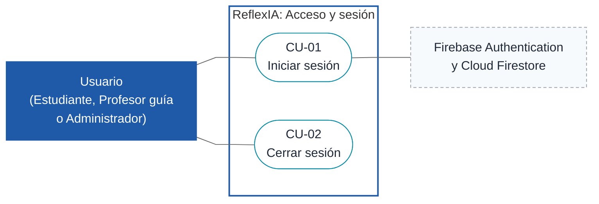
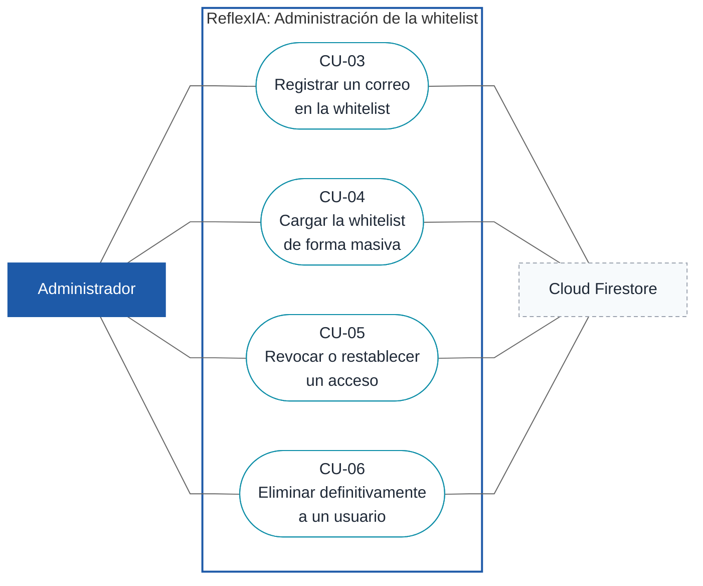
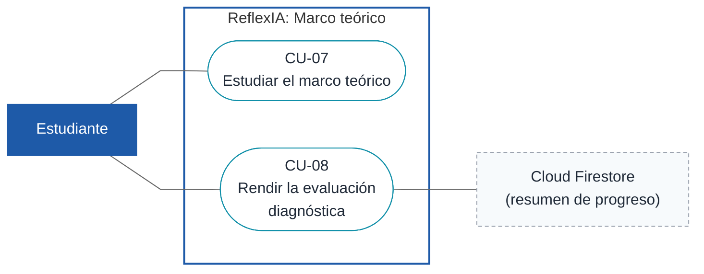
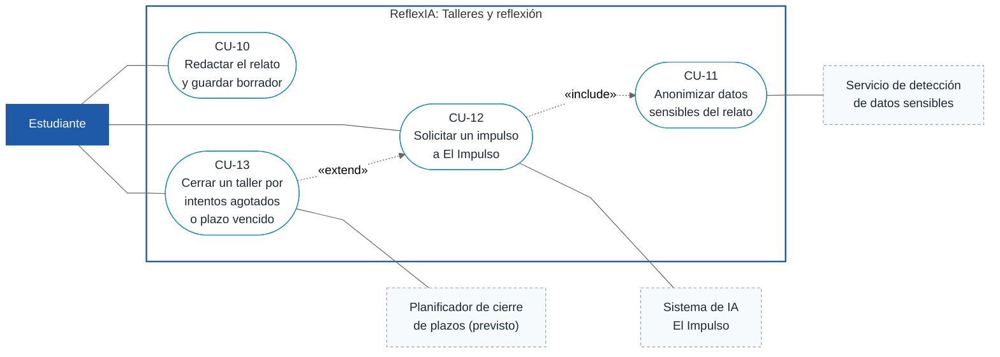
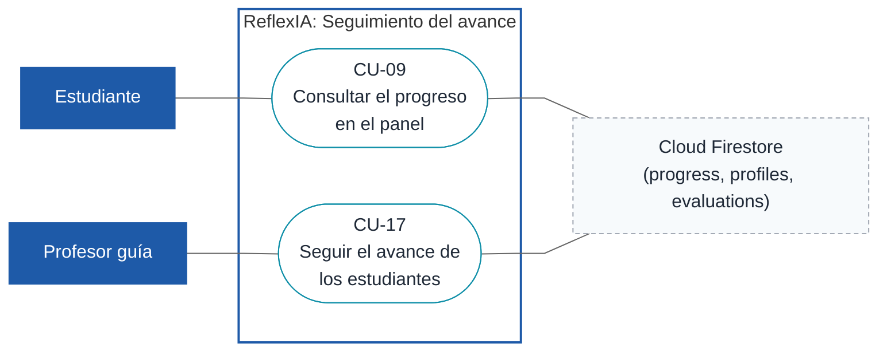
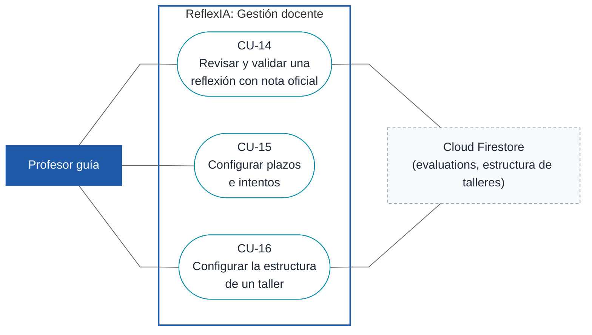
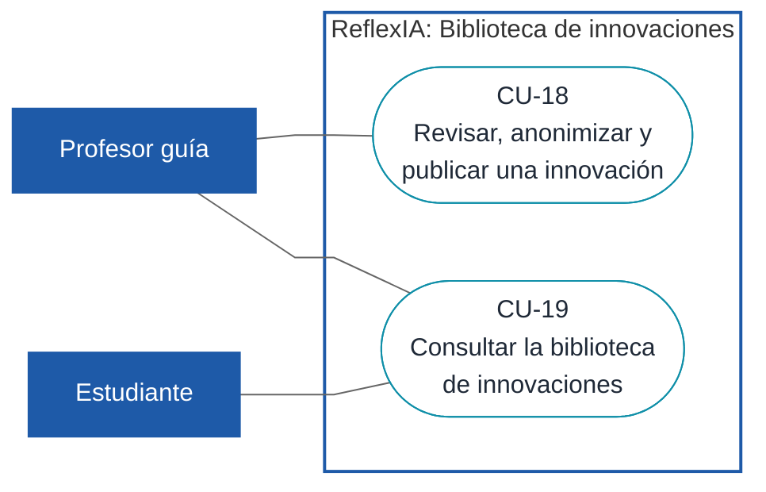

# 09. Diagramas de casos de uso

Los casos de uso de ReflexIA se agrupan en **siete diagramas por módulo**, para que cada uno sea legible y tenga un propósito claro. Cada diagrama va seguido de la tabla de sus casos. La ficha detallada de cada caso se redacta después (ver [08](./08-plan-casos-de-uso.md)).

## Cómo leer los diagramas

Mermaid no tiene notación nativa de casos de uso, así que se dibujan con diagramas de flujo siguiendo la convención UML:

| Elemento | Representación |
|---|---|
| Actor humano | Rectángulo azul |
| Sistema externo o proceso automático | Rectángulo gris punteado |
| Caso de uso | Óvalo con su ID y nombre |
| Límite del sistema | Recuadro "ReflexIA" |
| Asociación actor–caso | Línea continua |
| `«include»` | Línea punteada desde el caso base hacia el caso que siempre incluye |
| `«extend»` | Línea punteada desde el caso que extiende hacia el caso base |

## Índice

| Diagrama | Módulo | Casos |
|---|---|---|
| [D1](#d1-acceso-y-sesión) | Acceso y sesión | CU-01, CU-02 |
| [D2](#d2-administración-de-la-whitelist) | Administración de la whitelist | CU-03 a CU-06 |
| [D3](#d3-marco-teórico) | Marco teórico | CU-07, CU-08 |
| [D4](#d4-talleres-y-reflexión-del-estudiante) | Talleres y reflexión del estudiante | CU-10 a CU-13 |
| [D5](#d5-seguimiento-del-avance) | Seguimiento del avance | CU-09, CU-17 |
| [D6](#d6-gestión-docente) | Gestión docente | CU-14 a CU-16 |
| [D7](#d7-biblioteca-de-innovaciones) | Biblioteca de innovaciones | CU-18, CU-19 |

---

## D1. Acceso y sesión

Puerta de entrada común a los tres roles. Aplica la regla de acceso por whitelist (RN-01, RN-02).

| Caso | Actores | Requisito | Reglas |
|---|---|---|---|
| CU-01 Iniciar sesión | Estudiante, Profesor guía, Administrador; Firebase | RF-08 | RN-01, RN-02 |
| CU-02 Cerrar sesión | Estudiante, Profesor guía, Administrador | RF-08 | RN-02 |

---

## D2. Administración de la whitelist

Gestión del acceso a cargo del administrador.

| Caso | Actores | Requisito | Reglas | Notas |
|---|---|---|---|---|
| CU-03 Registrar un correo en la whitelist | Administrador | RF-01 | RN-01, RN-02 | |
| CU-04 Cargar la whitelist de forma masiva | Administrador | RF-01 | RN-01, RN-02 | Archivo CSV/Excel con vista previa. PEND-05 sobre la frecuencia de carga. |
| CU-05 Revocar o restablecer un acceso | Administrador | RF-01 | RN-03 | Acción reversible. |
| CU-06 Eliminar definitivamente a un usuario | Administrador | RF-01 | RN-03, RN-04 | Doble confirmación. No implementado (GAP-03). |

---

## D3. Marco teórico

Preparación conceptual del estudiante. Su aprobación desbloquea el Taller 1 (RN-08).

| Caso | Actores | Requisito | Reglas | Notas |
|---|---|---|---|---|
| CU-07 Estudiar el marco teórico | Estudiante | RF-04 | RN-07 | Referencias APA con DOI (GAP-04). |
| CU-08 Rendir la evaluación diagnóstica | Estudiante | RF-04 | RN-05, RN-06, RN-08 | Aprobación 8 de 10. Depende de PEND-01 y de GAP-01, GAP-02, GAP-09. |

---

## D4. Talleres y reflexión del estudiante

Núcleo del sistema: redacción del relato, resguardo de la privacidad y retroalimentación de la IA.

| Caso | Actores | Requisito | Reglas | Notas |
|---|---|---|---|---|
| CU-10 Redactar el relato y guardar borrador | Estudiante | RF-03 | RN-08, RN-09, RN-10 | Guardar un borrador no descuenta intentos. |
| CU-11 Anonimizar datos sensibles del relato | Estudiante; servicio de detección | RF-05 | RN-13, RN-19 | Siempre se ejecuta antes de pedir un impulso (`include` desde CU-12). GAP-06. |
| CU-12 Solicitar un impulso a "El Impulso" | Estudiante; Sistema de IA | RF-02 | RN-11, RN-12 | IA simulada (GAP-07). |
| CU-13 Cerrar un taller por intentos agotados o plazo vencido | Estudiante; Planificador | RF-06 | RN-11, RN-14, RN-15 | Extiende CU-12 cuando se agotan los intentos. Cierre por plazo no implementado (GAP-05). Depende de PEND-06 y PEND-07. |

---

## D5. Seguimiento del avance

Consulta del progreso: el estudiante ve el suyo y el profesor guía ve el de su curso.

| Caso | Actores | Requisito | Reglas | Notas |
|---|---|---|---|---|
| CU-09 Consultar el progreso en el panel | Estudiante | RF-P01 | RN-17 | Pendiente confirmar RNF-04 (máximo 2 clics) con el panel nuevo. |
| CU-17 Seguir el avance de los estudiantes | Profesor guía | RF-P01 | RN-16, RN-17, RN-19 | Solo números y estados, nunca el texto de los relatos. |

---

## D6. Gestión docente

Revisión de la retroalimentación, nota oficial y configuración del curso.

| Caso | Actores | Requisito | Reglas | Notas |
|---|---|---|---|---|
| CU-14 Revisar y validar una reflexión con nota oficial | Profesor guía | RF-02 | RN-12, RN-16 | La propuesta original de la IA no se modifica. |
| CU-15 Configurar plazos e intentos | Profesor guía | RF-06 | RN-11, RN-15 | Intentos: 3 por defecto (DEC-11). Depende de PEND-06. |
| CU-16 Configurar la estructura de un taller | Profesor guía | RF-P02 | RN-09 | Acuerdo del equipo, sin validar con la stakeholder (PEND-10). |

---

## D7. Biblioteca de innovaciones

Repositorio de propuestas destacadas (nota ≥ 6,0).

| Caso | Actores | Requisito | Reglas | Notas |
|---|---|---|---|---|
| CU-18 Revisar, anonimizar y publicar una innovación | Profesor guía | RF-07 | RN-18, RN-19 | Depende de PEND-03 (publicación automática o con revisión). |
| CU-19 Consultar la biblioteca de innovaciones | Estudiante, Profesor guía | RF-07 | RN-18 | Solo lectura. |

---

## Cobertura

Los 19 casos del catálogo aparecen en exactamente un diagrama. Cada requisito en alcance (RF-01 a RF-08, RF-P01 y RF-P02) está cubierto por al menos un caso.
