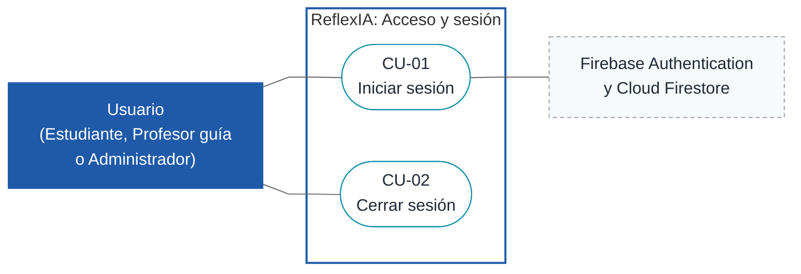
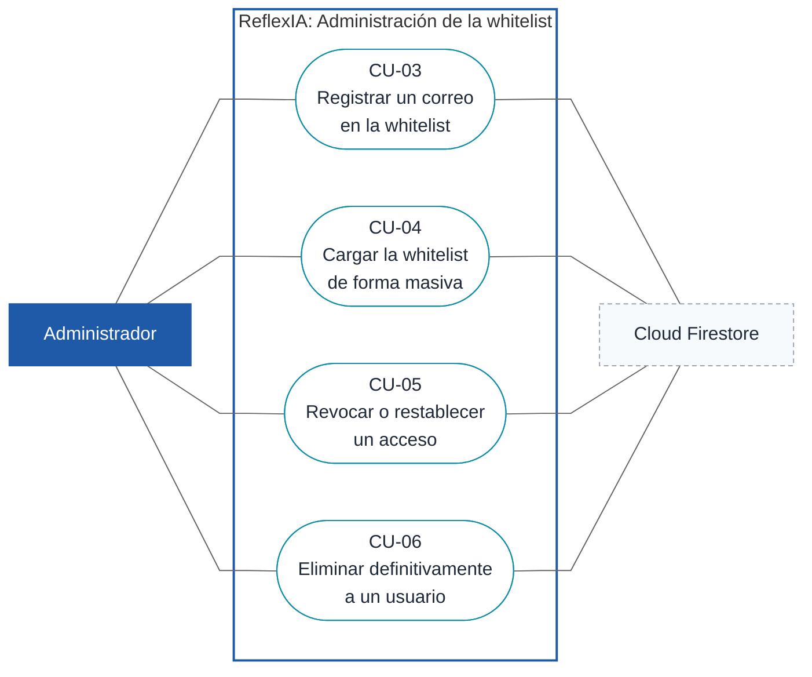
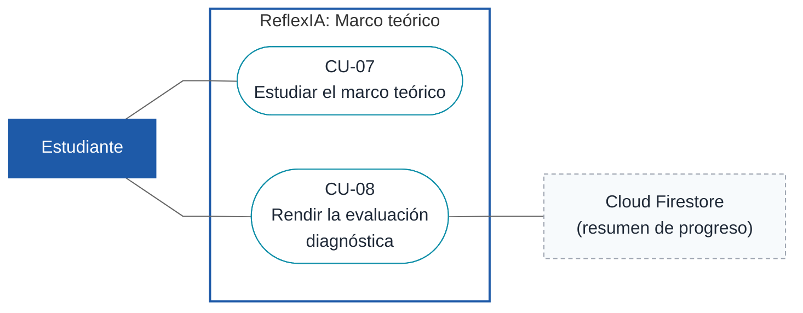
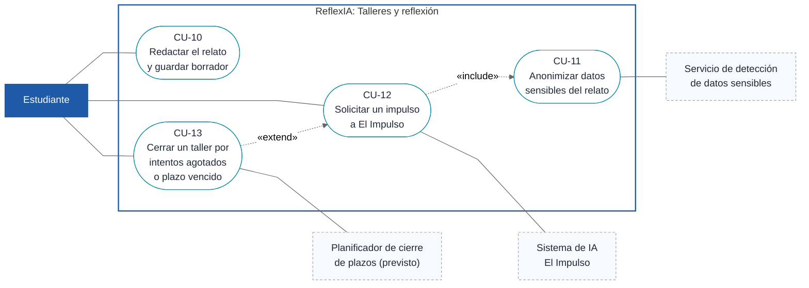
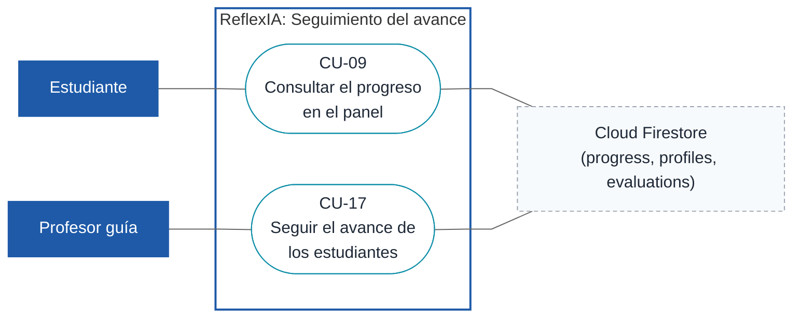
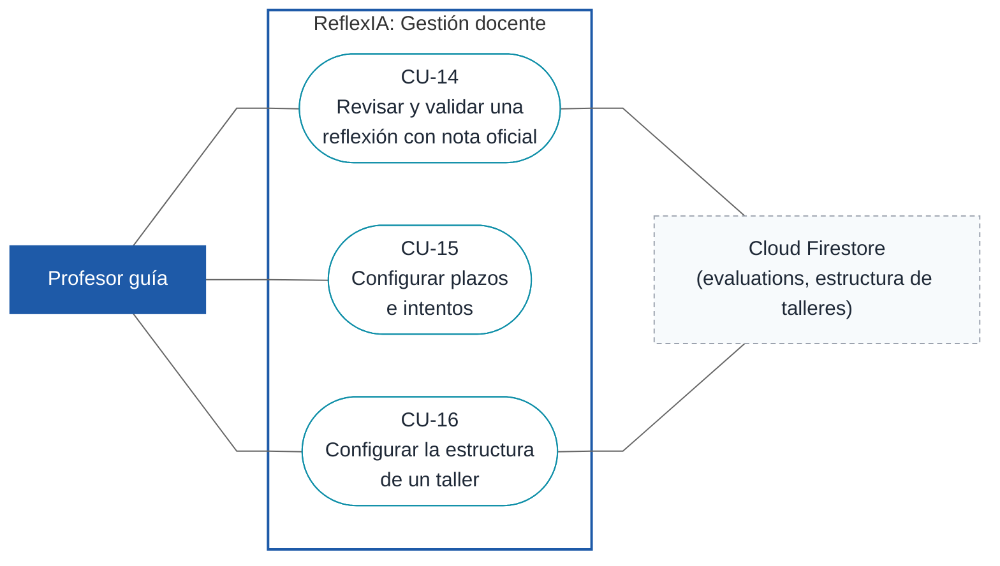

# Casos de uso de ReflexIA

Documento para compartir. Reúne los diagramas de casos de uso por módulo (D1 a D7) y las fichas de los casos que ya están listos para redactar. Describe el sistema tal como está implementado en el repositorio (DEC-06); donde el código aún no cumple la línea base, la ficha lo indica en **Comentarios**.

## Estado de los casos de uso

| Caso | Nombre | Diagrama | Estado |
|---|---|---|---|
| CU-01 | Iniciar sesión | D1 | Ficha lista |
| CU-02 | Cerrar sesión | D1 | Ficha lista |
| CU-03 | Registrar un correo en la whitelist | D2 | Ficha lista |
| CU-04 | Cargar la whitelist de forma masiva | D2 | Ficha lista |
| CU-05 | Revocar o restablecer un acceso | D2 | Ficha lista |
| CU-06 | Eliminar definitivamente a un usuario | D2 | Ficha lista |
| CU-07 | Estudiar el marco teórico | D3 | Ficha lista |
| CU-08 | Rendir la evaluación diagnóstica | D3 | Ficha lista |
| CU-09 | Consultar el progreso en el panel | D5 | Ficha lista |
| CU-10 | Redactar el relato de un taller y guardar borrador | D4 | Ficha lista |
| CU-11 | Anonimizar datos sensibles del relato | D4 | Ficha lista |
| CU-12 | Solicitar un impulso a "El Impulso" | D4 | Ficha lista |
| CU-13 | Cerrar un taller por intentos agotados o plazo vencido | D4 | Ficha pendiente: depende de PEND-06 (plazo fijo o configurable) y PEND-07 (nota al agotar intentos). |
| CU-14 | Revisar y validar una reflexión con nota oficial | D6 | Ficha lista |
| CU-15 | Configurar plazos e intentos | D6 | Ficha pendiente: depende de PEND-06 (plazo fijo o configurable). |
| CU-16 | Configurar la estructura de un taller | D6 | Ficha lista |
| CU-17 | Seguir el avance de los estudiantes | D5 | Ficha lista |
| CU-18 | Revisar, anonimizar y publicar una innovación | D7 | Ficha pendiente: depende de PEND-03 (publicación automática con nota 6,0 o más, o a cargo del docente). |
| CU-19 | Consultar la biblioteca de innovaciones | D7 | Ficha lista |

Resueltos hasta ahora: DEC-11 (3 intentos de revisión por taller, modificables por el profesor guía).

## Cómo leer los diagramas

Los diagramas usan la convención UML sobre diagramas de flujo de Mermaid: actor humano (rectángulo azul), sistema externo o proceso automático (rectángulo gris punteado), caso de uso (óvalo con su ID), límite del sistema (recuadro "ReflexIA"), asociación (línea continua), `«include»` (línea punteada hacia el caso incluido) y `«extend»` (línea punteada desde el caso que extiende).

Cada ficha sigue esta estructura: encabezado, secuencia normal, postcondición, excepciones por paso y comentarios con las reglas de negocio (RN), brechas (GAP) y pendientes (PEND).

---

## D1. Acceso y sesión

Puerta de entrada común a los tres roles. Aplica la regla de acceso por whitelist (RN-01, RN-02).

#### CU-01. Iniciar sesión

| Campo | Contenido |
|---|---|
| **Actores** | Usuario (Estudiante, Profesor guía o Administrador). Secundario: Firebase Authentication y Cloud Firestore. |
| **Descripción** | El usuario accede al sistema con su correo institucional y es llevado a su área según su rol. |
| **Requisitos** | RF-08, RNF-02, HU-01, HU-08 |
| **Precondición** | El correo del usuario está en la whitelist con estado activo. |

**Secuencia normal**

| Paso | Acción |
|---|---|
| 1 | El usuario abre la pantalla de inicio de sesión (`/iniciar-sesion`). |
| 2 | El sistema muestra el formulario de correo y contraseña. |
| 3 | El usuario ingresa su correo y su contraseña y confirma. |
| 4 | El sistema verifica que el correo pertenezca al dominio `@ucen.cl`. |
| 5 | El sistema autentica las credenciales con Firebase Authentication. |
| 6 | El sistema consulta la whitelist en Firestore, comprueba que el estado sea activo y obtiene el rol. |
| 7 | El sistema redirige al usuario a su área: estudiante a `/estudiante`, profesor guía a `/docente` y administrador a `/admin/whitelist`. |

**Postcondición:** Hay una sesión activa y el usuario está en el área que corresponde a su rol.

**Excepciones**

| Paso | Acción |
|---|---|
| 4 | Si el correo no es `@ucen.cl`: |
| E.1 | El sistema informa que el acceso no está permitido. |
| E.2 | Se cancela el caso de uso. |
| 5 | Si las credenciales son incorrectas: |
| E.3 | El sistema informa el error y permite reintentar desde el paso 3. |
| 6 | Si el correo no está en la whitelist o su acceso fue revocado: |
| E.4 | El sistema deniega el acceso y no deja una sesión abierta. |
| E.5 | Se cancela el caso de uso. |

**Comentarios:** RN-01 (solo `@ucen.cl` activo), RN-02 (roles y redirección). RNF-02: la validación debe tardar menos de 2 s. La bitácora de auditoría no está implementada (GAP-08).

#### CU-02. Cerrar sesión

| Campo | Contenido |
|---|---|
| **Actores** | Usuario (Estudiante, Profesor guía o Administrador). |
| **Descripción** | El usuario termina su sesión y vuelve a la pantalla de inicio de sesión. |
| **Requisitos** | RF-08 |
| **Precondición** | El usuario tiene una sesión activa. |

**Secuencia normal**

| Paso | Acción |
|---|---|
| 1 | El usuario elige la opción de cerrar sesión. |
| 2 | El sistema cierra la sesión en Firebase Authentication. |
| 3 | El sistema redirige al usuario a la pantalla de inicio de sesión. |

**Postcondición:** No hay sesión activa. Las rutas protegidas ya no son accesibles sin volver a iniciar sesión.

**Excepciones**

| Paso | Acción |
|---|---|
| 2 | Si el cierre de sesión falla: |
| E.1 | El sistema informa el problema y mantiene al usuario en su área. |

**Comentarios:** RN-02. Los borradores e intentos se guardan en almacenamiento local particionado por UID (RN-20); cerrar sesión no los borra.

---

## D2. Administración de la whitelist

Gestión del acceso a cargo del administrador.

#### CU-03. Registrar un correo en la whitelist

| Campo | Contenido |
|---|---|
| **Actores** | Administrador. Secundario: Cloud Firestore. |
| **Descripción** | El administrador autoriza a una persona a ingresar al sistema agregando su correo institucional con un rol. |
| **Requisitos** | RF-01, HU-01 |
| **Precondición** | El administrador inició sesión. |

**Secuencia normal**

| Paso | Acción |
|---|---|
| 1 | El administrador abre la gestión de la whitelist (`/admin/whitelist`). |
| 2 | El sistema muestra la lista de correos registrados con su rol y estado. |
| 3 | El administrador elige agregar un correo, ingresa el correo y selecciona el rol. |
| 4 | El sistema valida que el correo sea `@ucen.cl` y que no esté ya registrado. |
| 5 | El sistema guarda el correo en Firestore con estado activo. |
| 6 | El sistema muestra el correo en la lista. |

**Postcondición:** El correo queda registrado como activo con su rol y la persona puede iniciar sesión.

**Excepciones**

| Paso | Acción |
|---|---|
| 4 | Si el correo no es `@ucen.cl`: |
| E.1 | El sistema informa que el dominio no es válido y no guarda el correo. |
| 4 | Si el correo ya está registrado: |
| E.2 | El sistema informa que ya existe y no crea un duplicado. |

**Comentarios:** RN-01, RN-02. Dominio único `@ucen.cl` (DEC-03). Cada alta debería dejar registro de auditoría (RN-04, GAP-08).

#### CU-04. Cargar la whitelist de forma masiva

| Campo | Contenido |
|---|---|
| **Actores** | Administrador. Secundario: Cloud Firestore. |
| **Descripción** | El administrador registra muchos correos a la vez desde un archivo CSV o Excel. |
| **Requisitos** | RF-01, HU-01 |
| **Precondición** | El administrador inició sesión y tiene un archivo CSV o Excel con los correos. |

**Secuencia normal**

| Paso | Acción |
|---|---|
| 1 | El administrador abre la gestión de la whitelist y elige la carga masiva. |
| 2 | El administrador selecciona el archivo. |
| 3 | El sistema lee el archivo y muestra una vista previa con las filas válidas y las filas con error. |
| 4 | El administrador revisa la vista previa y confirma la carga. |
| 5 | El sistema guarda en Firestore los correos válidos con estado activo. |
| 6 | El sistema informa cuántos correos se agregaron y cuántos se omitieron. |

**Postcondición:** Los correos válidos quedan registrados como activos. Las filas con error no se guardan.

**Excepciones**

| Paso | Acción |
|---|---|
| 2 | Si el archivo no es CSV ni Excel o no se puede leer: |
| E.1 | El sistema informa el problema y no continúa. |
| 3 | Si una fila tiene un correo que no es `@ucen.cl` o está repetido: |
| E.2 | El sistema la marca en la vista previa y la excluye de la carga. |
| 4 | Si el administrador cancela: |
| E.3 | No se guarda ningún correo. |

**Comentarios:** RN-01, RN-02. PEND-05: falta definir si cada semestre la carga es manual o por enrolamiento automático.

#### CU-05. Revocar o restablecer un acceso

| Campo | Contenido |
|---|---|
| **Actores** | Administrador. Secundario: Cloud Firestore. |
| **Descripción** | El administrador quita el acceso a un usuario sin borrarlo, o se lo devuelve. |
| **Requisitos** | RF-01, HU-01 |
| **Precondición** | El administrador inició sesión y el usuario existe en la whitelist. |

**Secuencia normal**

| Paso | Acción |
|---|---|
| 1 | El administrador abre la gestión de la whitelist. |
| 2 | El administrador busca o filtra al usuario. |
| 3 | El administrador elige revocar el acceso del usuario (o restablecerlo si estaba revocado). |
| 4 | El sistema pide confirmación. |
| 5 | El administrador confirma. |
| 6 | El sistema cambia el estado en Firestore (activo o revocado) y actualiza la lista. |

**Postcondición:** El usuario queda con estado revocado (no puede iniciar sesión) o activo (puede volver a ingresar).

**Excepciones**

| Paso | Acción |
|---|---|
| 4 | Si el administrador no confirma: |
| E.1 | No se modifica el estado. |
| 6 | Si falla el guardado: |
| E.2 | El sistema informa el error y conserva el estado anterior. |

**Comentarios:** RN-03: la revocación es reversible. Para borrar a un usuario ver CU-06.

#### CU-06. Eliminar definitivamente a un usuario

| Campo | Contenido |
|---|---|
| **Actores** | Administrador. Secundario: Cloud Firestore. |
| **Descripción** | El administrador borra de la whitelist a un estudiante que se retira de la asignatura. |
| **Requisitos** | RF-01, HU-01 |
| **Precondición** | El administrador inició sesión y el usuario es un estudiante registrado. |

**Secuencia normal**

| Paso | Acción |
|---|---|
| 1 | El administrador abre la gestión de la whitelist y busca al usuario. |
| 2 | El administrador elige eliminar definitivamente al usuario. |
| 3 | El sistema muestra una primera confirmación que advierte que la acción no se puede deshacer. |
| 4 | El administrador confirma. |
| 5 | El sistema muestra una segunda confirmación (por ejemplo, volver a escribir el correo). |
| 6 | El administrador confirma. |
| 7 | El sistema elimina al usuario de la whitelist y registra la acción en la bitácora de auditoría. |

**Postcondición:** El usuario ya no figura en la whitelist y no puede ingresar. Queda un registro de auditoría.

**Excepciones**

| Paso | Acción |
|---|---|
| 4, 6 | Si el administrador cancela en cualquier confirmación: |
| E.1 | No se elimina nada. |
| 1 | Si el usuario no es estudiante: |
| E.2 | El sistema no ofrece la eliminación definitiva; solo la revocación (CU-05). |

**Comentarios:** RN-03, RN-04. **No implementado** (GAP-03): hoy solo existe la revocación. Esta ficha describe el comportamiento objetivo (DEC-07).

---

## D3. Marco teórico

Preparación conceptual del estudiante. Su aprobación desbloquea el Taller 1 (RN-08).

#### CU-07. Estudiar el marco teórico

| Campo | Contenido |
|---|---|
| **Actores** | Estudiante. |
| **Descripción** | El estudiante consulta las referencias que debe estudiar antes de rendir la evaluación diagnóstica. |
| **Requisitos** | RF-04, HU-04 |
| **Precondición** | El estudiante inició sesión. |

**Secuencia normal**

| Paso | Acción |
|---|---|
| 1 | El estudiante abre el marco teórico (`/estudiante/marco-teorico`). |
| 2 | El sistema muestra la lista de referencias bibliográficas en formato APA, cada una con su enlace DOI. |
| 3 | El estudiante lee las referencias y abre los enlaces que necesite. |
| 4 | El estudiante decide pasar a la evaluación diagnóstica (CU-08). |

**Postcondición:** No cambia el estado del sistema.

**Excepciones**

| Paso | Acción |
|---|---|
| 2 | Si un enlace DOI no abre: |
| E.1 | El estudiante puede reintentar o continuar con las demás referencias. |

**Comentarios:** RN-07. **Brecha** (GAP-04): hoy no existe la lista de referencias APA con DOI; esta ficha describe el comportamiento objetivo.

#### CU-08. Rendir la evaluación diagnóstica

| Campo | Contenido |
|---|---|
| **Actores** | Estudiante. Secundario: Cloud Firestore. |
| **Descripción** | El estudiante responde el cuestionario del marco teórico para desbloquear el Taller 1. |
| **Requisitos** | RF-04, HU-04 |
| **Precondición** | El estudiante inició sesión y aún no ha aprobado la evaluación. |

**Secuencia normal**

| Paso | Acción |
|---|---|
| 1 | El estudiante elige rendir la evaluación diagnóstica. |
| 2 | El sistema selecciona 10 preguntas al azar de un banco de 30 e inicia el temporizador. |
| 3 | El estudiante responde las preguntas. |
| 4 | El estudiante envía sus respuestas. |
| 5 | El sistema cuenta los aciertos. |
| 6 | Si hay 8 o más aciertos, el sistema marca el marco teórico como aprobado y desbloquea el Taller 1. |
| 7 | El sistema guarda el resultado y el resumen de progreso en Firestore y muestra el resultado al estudiante. |

**Postcondición:** El resultado queda registrado. Si aprobó, el Taller 1 queda habilitado.

**Excepciones**

| Paso | Acción |
|---|---|
| 2 | Si el tiempo se agota: |
| E.1 | El sistema cierra la evaluación con las respuestas dadas hasta ese momento y continúa en el paso 5. |
| 6 | Si hay menos de 8 aciertos: |
| E.2 | El sistema informa que no aprobó y permite un nuevo intento. El Taller 1 sigue bloqueado. |

**Comentarios:** RN-05 (8 de 10), RN-06 (intentos ilimitados; nota máxima 7,0 en los intentos 1 a 3, 5,0 en 4 a 6 y 4,0 en 7 a 9), RN-08. **Brechas:** hoy se aprueba con 7 de 10 y hay máximo 3 intentos (GAP-01, GAP-02); no se calcula la nota con tope (GAP-09). PEND-01: falta definir el cálculo de la nota y el tope desde el intento 10.

---

## D4. Talleres y reflexión del estudiante

Núcleo del sistema: redacción del relato, resguardo de la privacidad y retroalimentación de la IA.

#### CU-10. Redactar el relato de un taller y guardar borrador

| Campo | Contenido |
|---|---|
| **Actores** | Estudiante. |
| **Descripción** | El estudiante escribe, paso a paso, el relato de un taller y puede guardarlo como borrador. |
| **Requisitos** | RF-03, HU-03 |
| **Precondición** | El estudiante inició sesión y el taller está desbloqueado. |

**Secuencia normal**

| Paso | Acción |
|---|---|
| 1 | El estudiante abre un taller (`/estudiante/talleres/:workshopId`). |
| 2 | El sistema muestra el Objetivo, la Actividad y el Producto esperado, el asistente por pasos y el panel de referencias. |
| 3 | El estudiante completa las cuatro secciones del relato: Contexto, Descripción del hecho, Actores e influencia y Relevancia pedagógica. |
| 4 | El estudiante elige guardar borrador. |
| 5 | El sistema guarda el borrador en el almacenamiento local del usuario (por UID) y confirma el guardado. |

**Postcondición:** El borrador queda guardado. El contador de intentos no cambia.

**Excepciones**

| Paso | Acción |
|---|---|
| 2 | Si el taller está bloqueado: |
| E.1 | El sistema impide el acceso e indica la condición pendiente. |
| 3 | Si el plazo venció o se agotaron los intentos: |
| E.2 | El sistema bloquea la edición (ver CU-13). |

**Comentarios:** RN-08, RN-09, RN-10 (guardar un borrador nunca descuenta intentos), RN-20. GAP-11: falta verificar títulos oficiales, bloques Objetivo/Actividad/Producto y la ubicación del panel a la derecha.

#### CU-11. Anonimizar datos sensibles del relato

| Campo | Contenido |
|---|---|
| **Actores** | Estudiante. Secundario: servicio de detección de datos sensibles. |
| **Descripción** | El estudiante reemplaza los nombres de personas, colegios y lugares del relato para poder enviarlo a la IA. |
| **Requisitos** | RF-05, RNF-01, HU-05 |
| **Precondición** | El estudiante tiene un relato en edición. Este caso se ejecuta como parte de CU-12. |

**Secuencia normal**

| Paso | Acción |
|---|---|
| 1 | El sistema envía el texto del relato al servicio de detección. |
| 2 | El servicio devuelve los nombres de personas, colegios y ubicaciones que encontró. |
| 3 | El sistema los resalta en el editor y muestra la norma de anonimización. |
| 4 | El sistema deshabilita el envío a la IA. |
| 5 | El estudiante reemplaza cada término por una etiqueta genérica (por ejemplo, "Estudiante A" o "Colegio X"). |
| 6 | El sistema vuelve a analizar el texto. |
| 7 | Cuando no quedan términos marcados, el sistema habilita el envío a la IA. |

**Postcondición:** El relato no contiene datos identificables y el envío a la IA está habilitado.

**Excepciones**

| Paso | Acción |
|---|---|
| 1 | Si el servicio de detección no responde: |
| E.1 | El sistema informa el problema y mantiene el envío deshabilitado. |
| 1 | Si no se detecta ningún dato sensible: |
| E.2 | El caso termina en el paso 7 sin resaltar nada. |

**Comentarios:** RN-13, RN-19. RNF-01: respuesta en 2 s o menos. **Brecha** (GAP-06): hoy la detección se hace desde el cliente con OpenRouter, sin servicio propio.

#### CU-12. Solicitar un impulso a "El Impulso"

| Campo | Contenido |
|---|---|
| **Actores** | Estudiante. Secundario: Sistema de IA. |
| **Descripción** | El estudiante pide a "El Impulso" orientaciones para profundizar su reflexión. |
| **Requisitos** | RF-02, RNF-05, HU-02 |
| **Precondición** | El estudiante tiene un relato en edición y le quedan intentos de revisión en el taller. |

**Secuencia normal**

| Paso | Acción |
|---|---|
| 1 | El estudiante elige solicitar un impulso. |
| 2 | El sistema ejecuta el caso de uso CU-11 (anonimización). |
| 3 | El sistema descuenta 1 intento del taller y actualiza el contador. |
| 4 | El sistema analiza el relato según la rúbrica del taller. |
| 5 | El sistema muestra en el panel "El Impulso" orientaciones sobre los criterios omitidos, sin redactar ni corregir el texto. |
| 6 | El estudiante lee las orientaciones y puede seguir editando su relato. |

**Postcondición:** Se registró el intento y las orientaciones quedan disponibles para el estudiante y para la revisión del profesor guía.

**Excepciones**

| Paso | Acción |
|---|---|
| 2 | Si el relato aún tiene datos sensibles: |
| E.1 | El sistema bloquea el envío hasta que se anonimice (CU-11). |
| 1 | Si no quedan intentos: |
| E.2 | El sistema bloquea la edición y se aplica CU-13. |
| 4 | Si la IA no responde: |
| E.3 | El sistema informa el error. |

**Comentarios:** RN-11 (el límite es de 3 intentos por taller, modificable por el profesor guía; DEC-11), RN-12, RN-13. RNF-05: respuesta en 10 s o menos. **Brecha** (GAP-07): hoy los impulsos son una simulación local sin modelo real. Pendiente definir si un error de la IA descuenta el intento.

#### CU-13. Cerrar un taller por intentos agotados o plazo vencido

*Ficha pendiente.* Depende de PEND-06 (plazo fijo o configurable) y PEND-07 (nota al agotar intentos).

---

## D5. Seguimiento del avance

Consulta del progreso: el estudiante ve el suyo y el profesor guía ve el de su curso.

#### CU-09. Consultar el progreso en el panel

| Campo | Contenido |
|---|---|
| **Actores** | Estudiante. Secundario: Cloud Firestore. |
| **Descripción** | El estudiante revisa su avance en el marco teórico y en los talleres y entra a los que tiene habilitados. |
| **Requisitos** | RF-P01, RNF-04 |
| **Precondición** | El estudiante inició sesión. |

**Secuencia normal**

| Paso | Acción |
|---|---|
| 1 | El estudiante abre su panel de progreso (`/estudiante`). |
| 2 | El sistema lee el resumen de progreso desde Firestore. |
| 3 | El sistema muestra el marco teórico y los cuatro talleres con su estado (bloqueado, habilitado, entregado) y su color de desempeño. |
| 4 | El estudiante elige un elemento habilitado. |
| 5 | El sistema lo abre (marco teórico o taller). |

**Postcondición:** No cambia el estado del sistema.

**Excepciones**

| Paso | Acción |
|---|---|
| 4 | Si el estudiante elige un taller bloqueado: |
| E.1 | El sistema informa qué condición falta para desbloquearlo. |

**Comentarios:** RN-08, RN-17 (gris: no entregado; rojo: menor que 4,0; azul: 4,0 a 4,9; verde esmeralda: 5,0 a 7,0). RNF-04: cualquier taller habilitado debe alcanzarse en máximo 2 clics desde este panel.

#### CU-17. Seguir el avance de los estudiantes

| Campo | Contenido |
|---|---|
| **Actores** | Profesor guía. Secundario: Cloud Firestore. |
| **Descripción** | El profesor guía ve el avance semanal de sus estudiantes en el marco teórico y en los talleres. |
| **Requisitos** | RF-P01 |
| **Precondición** | El profesor guía inició sesión. |

**Secuencia normal**

| Paso | Acción |
|---|---|
| 1 | El profesor guía abre el panel de seguimiento (`/docente`). |
| 2 | El sistema lee el avance de los estudiantes desde Firestore. |
| 3 | El sistema muestra, por estudiante, el estado del marco teórico y de cada taller, con las notas y sus colores de desempeño. |
| 4 | El profesor guía filtra por situación o por notas. |
| 5 | El sistema actualiza la lista según el filtro. |

**Postcondición:** No cambia el estado del sistema.

**Excepciones**

| Paso | Acción |
|---|---|
| 3 | Si no hay estudiantes con datos de avance: |
| E.1 | El sistema muestra la lista vacía. |

**Comentarios:** RN-16, RN-17, RN-19: el panel muestra solo números y estados, nunca el texto de los relatos.

---

## D6. Gestión docente

Revisión de la retroalimentación, nota oficial y configuración del curso.

#### CU-14. Revisar y validar una reflexión con nota oficial

| Campo | Contenido |
|---|---|
| **Actores** | Profesor guía. Secundario: Cloud Firestore. |
| **Descripción** | El profesor guía revisa la retroalimentación de la IA sobre una reflexión y registra la nota oficial. |
| **Requisitos** | RF-02, HU-02 |
| **Precondición** | El profesor guía inició sesión y hay reflexiones entregadas. |

**Secuencia normal**

| Paso | Acción |
|---|---|
| 1 | El profesor guía abre la revisión de reflexiones (`/docente/reflexiones`). |
| 2 | El sistema lista las reflexiones por revisar. |
| 3 | El profesor guía elige una reflexión. |
| 4 | El sistema muestra el relato y la propuesta de la IA. |
| 5 | El profesor guía confirma o edita las orientaciones. |
| 6 | El profesor guía ingresa la nota oficial (de 1,0 a 7,0) y valida. |
| 7 | El sistema guarda la validación y la nota en Firestore. |

**Postcondición:** La reflexión queda validada con su nota oficial. La propuesta original de la IA se conserva sin cambios.

**Excepciones**

| Paso | Acción |
|---|---|
| 6 | Si la nota está fuera del rango de 1,0 a 7,0: |
| E.1 | El sistema no la acepta e indica el rango válido. |
| 7 | Si falla el guardado: |
| E.2 | La reflexión no se considera validada; el sistema informa el error. |

**Comentarios:** RN-12, RN-16: la nota oficial solo existe si está guardada en Firestore y solo la escribe el profesor guía.

#### CU-15. Configurar plazos e intentos

*Ficha pendiente.* Depende de PEND-06 (plazo fijo o configurable).

#### CU-16. Configurar la estructura de un taller

| Campo | Contenido |
|---|---|
| **Actores** | Profesor guía. Secundario: Cloud Firestore. |
| **Descripción** | El profesor guía define qué ve y responde el estudiante en un taller. |
| **Requisitos** | RF-P02, HU-09 |
| **Precondición** | El profesor guía inició sesión. |

**Secuencia normal**

| Paso | Acción |
|---|---|
| 1 | El profesor guía abre la estructura de talleres (`/docente/estructura-talleres`). |
| 2 | El sistema lista los talleres. |
| 3 | El profesor guía elige un taller. |
| 4 | El profesor guía edita su contenido: texto o relato, preguntas de alternativas y respuestas abiertas. Puede importar preguntas desde un archivo CSV. |
| 5 | El profesor guía guarda. |
| 6 | El sistema guarda la estructura en Firestore. |
| 7 | El estudiante ve la nueva estructura en el asistente del taller. |

**Postcondición:** La estructura del taller queda actualizada y se muestra en el asistente del estudiante.

**Excepciones**

| Paso | Acción |
|---|---|
| 4 | Si el archivo CSV no tiene el formato esperado: |
| E.1 | El sistema informa el error y no importa nada. |
| 6 | Si falla el guardado: |
| E.2 | El sistema informa el error y conserva la estructura anterior. |

**Comentarios:** RN-09. Es un acuerdo del equipo, aún sin validar con la stakeholder (DEC-09, PEND-10).

---

## D7. Biblioteca de innovaciones

Repositorio de propuestas destacadas (nota ≥ 6,0).

#### CU-18. Revisar, anonimizar y publicar una innovación

*Ficha pendiente.* Depende de PEND-03 (publicación automática con nota 6,0 o más, o a cargo del docente).

#### CU-19. Consultar la biblioteca de innovaciones

| Campo | Contenido |
|---|---|
| **Actores** | Estudiante o Profesor guía. |
| **Descripción** | El usuario lee propuestas de innovación destacadas, anonimizadas, como referencia. |
| **Requisitos** | RF-07, HU-07 |
| **Precondición** | El usuario inició sesión como estudiante o profesor guía. |

**Secuencia normal**

| Paso | Acción |
|---|---|
| 1 | El usuario abre la biblioteca de innovaciones (`/estudiante/innovaciones` o `/docente/innovaciones`). |
| 2 | El sistema muestra las propuestas publicadas. |
| 3 | El usuario busca por texto libre o filtra por categoría. |
| 4 | El sistema actualiza la lista. |
| 5 | El usuario elige una propuesta. |
| 6 | El sistema muestra el detalle para lectura. |

**Postcondición:** No cambia el estado del sistema.

**Excepciones**

| Paso | Acción |
|---|---|
| 4 | Si no hay propuestas que coincidan: |
| E.1 | El sistema informa que no hay resultados. |

**Comentarios:** RN-18: solo se muestran propuestas con nota de 6,0 o más y anonimizadas. Es de solo lectura.

---
