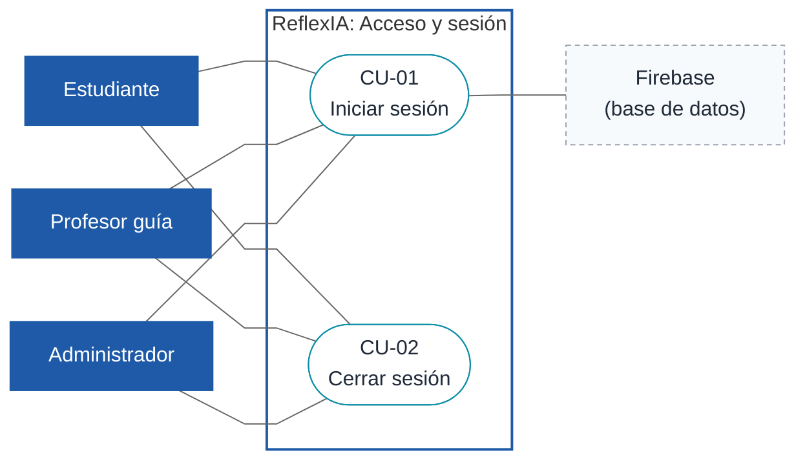
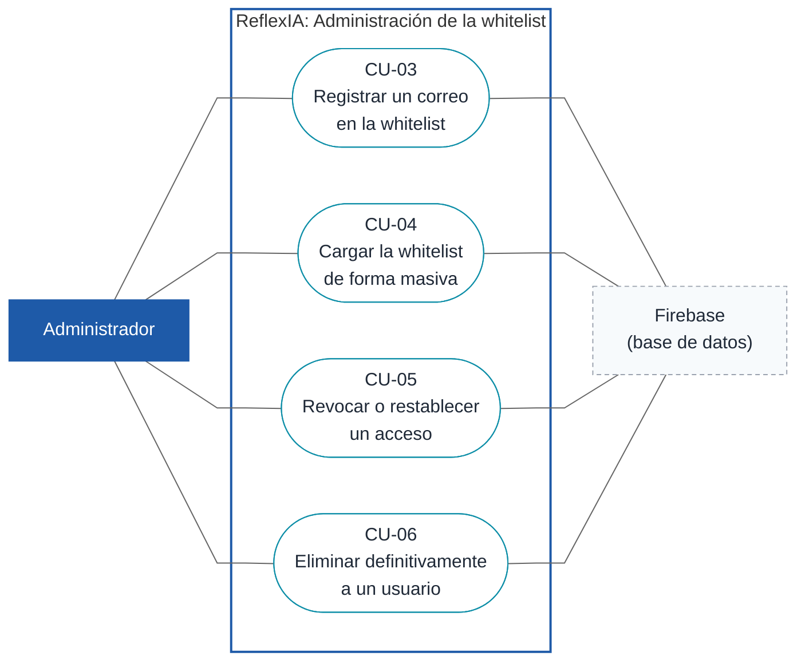
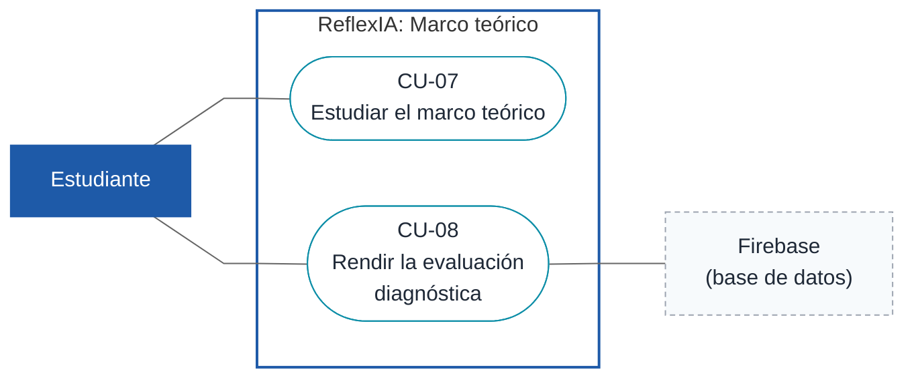
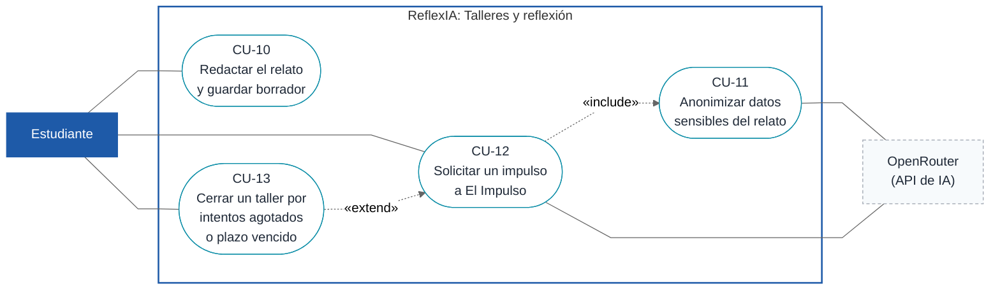
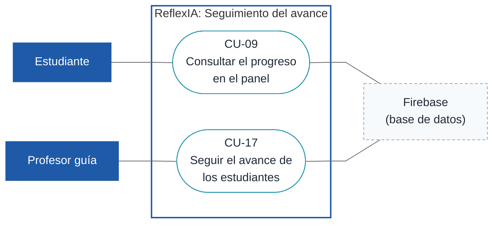
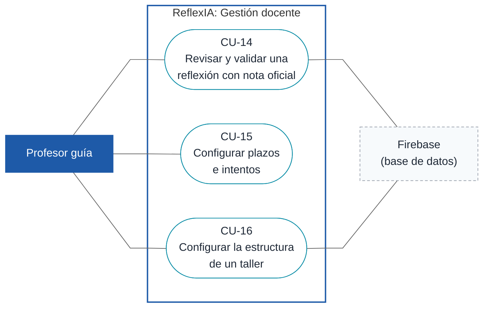
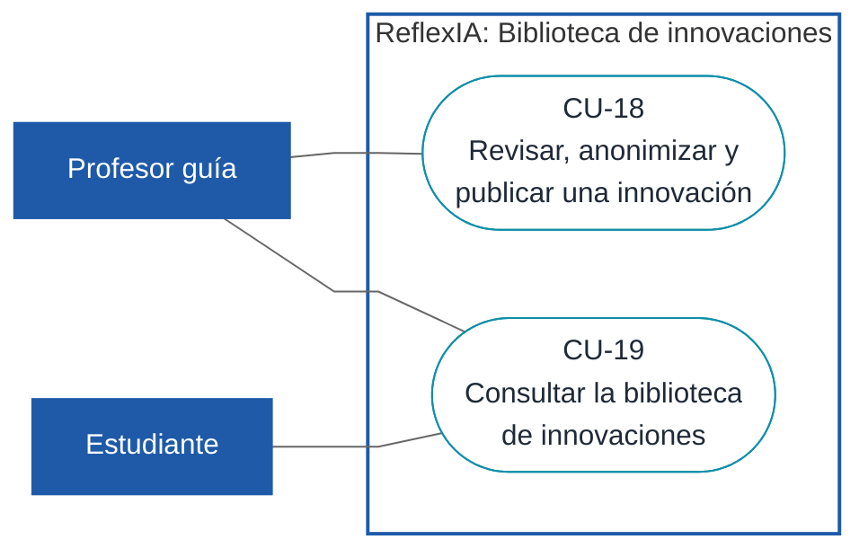

# Casos de uso de ReflexIA

Documento para compartir. Reúne los diagramas de casos de uso por módulo (D1 a D7) y las fichas de los casos que ya están listos para redactar. Describe el sistema tal como está implementado en el repositorio (DEC-06); donde el código aún no cumple la línea base, la ficha lo indica en **Comentarios**.

## Estado de los casos de uso

| Caso | Nombre | Diagrama | Estado |
|---|---|---|---|
| CU-01 | Iniciar sesión | D1 | Ficha lista |
| CU-02 | Cerrar sesión | D1 | Ficha lista |
| CU-03 | Registrar un correo en la whitelist | D2 | Ficha lista |
| CU-04 | Cargar la whitelist de forma masiva | D2 | Ficha lista |
| CU-05 | Revocar o restablecer un acceso | D2 | Ficha lista |
| CU-06 | Eliminar definitivamente a un usuario | D2 | Ficha lista |
| CU-07 | Estudiar el marco teórico | D3 | Ficha lista |
| CU-08 | Rendir la evaluación diagnóstica | D3 | Ficha lista |
| CU-09 | Consultar el progreso en el panel | D5 | Ficha lista |
| CU-10 | Redactar el relato de un taller y guardar borrador | D4 | Ficha lista |
| CU-11 | Anonimizar datos sensibles del relato | D4 | Ficha lista |
| CU-12 | Solicitar un impulso a "El Impulso" | D4 | Ficha lista |
| CU-13 | Cerrar un taller por intentos agotados o plazo vencido | D4 | Ficha lista |
| CU-14 | Revisar y validar una reflexión con nota oficial | D6 | Ficha lista |
| CU-15 | Configurar plazos e intentos | D6 | Ficha lista |
| CU-16 | Configurar la estructura de un taller | D6 | Ficha lista |
| CU-17 | Seguir el avance de los estudiantes | D5 | Ficha lista |
| CU-18 | Revisar, anonimizar y publicar una innovación | D7 | Ficha lista |
| CU-19 | Consultar la biblioteca de innovaciones | D7 | Ficha lista |

Actores del sistema: Estudiante, Profesor guía, Administrador, Firebase (base de datos) y OpenRouter (API de IA).

Resueltos hasta ahora: DEC-11 (3 intentos de revisión por taller, modificables por el profesor guía), DEC-12 (la IA sugiere la nota, el profesor guía la fija; 7,0 para avanzar; al agotar intentos queda la más alta), DEC-13 (el profesor guía configura el plazo y el taller se cierra solo) y DEC-14 (el profesor guía publica las innovaciones con aviso de confirmación).

## Cómo leer los diagramas

Los diagramas usan la convención UML sobre diagramas de flujo de Mermaid: actor humano (rectángulo azul), sistema externo o proceso automático (rectángulo gris punteado), caso de uso (óvalo con su ID), límite del sistema (recuadro "ReflexIA"), asociación (línea continua), `«include»` (línea punteada hacia el caso incluido) y `«extend»` (línea punteada desde el caso que extiende).

Cada ficha sigue la estructura de la plantilla del curso: encabezado con el identificador y el nombre del caso, versión, dependencias (requisitos y reglas de negocio), precondición, descripción, secuencia normal, postcondición, excepciones por paso y comentarios. Los actores se escriben en cursiva dentro de los pasos. Las brechas (GAP) y los pendientes (PEND) se señalan en los comentarios.

---

## D1. Acceso y sesión

Puerta de entrada común a los tres roles. Aplica la regla de acceso por whitelist (RN-01, RN-02).

#### CU-01. Iniciar sesión

<table>
<tr><th>CU-01</th><th colspan="2">Iniciar sesión</th></tr>
<tr><td><b>Versión</b></td><td colspan="2">1.0 (23/10/2026)</td></tr>
<tr><td><b>Dependencias</b></td><td colspan="2"><ul><li>RF-08 Autenticación institucional segura</li><li>RNF-02 Seguridad y acceso</li><li>Historia de usuario HU-01</li><li>Historia de usuario HU-08</li><li>RN-01 Acceso solo con correo @ucen.cl activo</li><li>RN-02 Roles y redirección por área</li></ul></td></tr>
<tr><td><b>Precondición</b></td><td colspan="2"><i>El correo del usuario está en la whitelist con estado activo.</i></td></tr>
<tr><td><b>Descripción</b></td><td colspan="2">El sistema deberá comportarse como se describe en el siguiente caso de uso cuando un <i>usuario</i> (estudiante, profesor guía o administrador) solicite iniciar sesión con su correo institucional.</td></tr>
<tr><td rowspan="8"><b>Secuencia normal</b></td><th>Paso</th><th>Acción</th></tr>
<tr><td>1</td><td>El <i>usuario</i> abre la pantalla de inicio de sesión (<code>/iniciar-sesion</code>).</td></tr>
<tr><td>2</td><td>El sistema muestra el formulario de correo y contraseña.</td></tr>
<tr><td>3</td><td>El <i>usuario</i> ingresa su correo y su contraseña y confirma.</td></tr>
<tr><td>4</td><td>El sistema verifica que el correo pertenezca al dominio <code>@ucen.cl</code>.</td></tr>
<tr><td>5</td><td>El sistema autentica las credenciales con Firebase.</td></tr>
<tr><td>6</td><td>El sistema consulta la whitelist en Firestore, comprueba que el estado sea activo y obtiene el rol.</td></tr>
<tr><td>7</td><td>El sistema redirige al <i>usuario</i> a su área: estudiante a <code>/estudiante</code>, profesor guía a <code>/docente</code> y administrador a <code>/admin/whitelist</code>.</td></tr>
<tr><td><b>Postcondición</b></td><td colspan="2"><i>Hay una sesión activa y el usuario está en el área que corresponde a su rol.</i></td></tr>
<tr><td rowspan="9"><b>Excepciones</b></td><th>Paso</th><th>Acción</th></tr>
<tr><td>4</td><td>Si el correo no es <code>@ucen.cl</code>,</td></tr>
<tr><td>E.1</td><td>El sistema informa que el acceso no está permitido.</td></tr>
<tr><td>E.2</td><td>Se cancela el caso de uso.</td></tr>
<tr><td>5</td><td>Si las credenciales son incorrectas,</td></tr>
<tr><td>E.3</td><td>El sistema informa el error y permite reintentar desde el paso 3.</td></tr>
<tr><td>6</td><td>Si el correo no está en la whitelist o su acceso fue revocado,</td></tr>
<tr><td>E.4</td><td>El sistema deniega el acceso y no deja una sesión abierta.</td></tr>
<tr><td>E.5</td><td>Se cancela el caso de uso.</td></tr>
<tr><td><b>Comentarios</b></td><td colspan="2">RN-01 (solo <code>@ucen.cl</code> activo), RN-02 (roles y redirección). RNF-02: la validación debe tardar menos de 2 s. La bitácora de auditoría no está implementada (GAP-08).</td></tr>
</table>

#### CU-02. Cerrar sesión

<table>
<tr><th>CU-02</th><th colspan="2">Cerrar sesión</th></tr>
<tr><td><b>Versión</b></td><td colspan="2">1.0 (23/10/2026)</td></tr>
<tr><td><b>Dependencias</b></td><td colspan="2"><ul><li>RF-08 Autenticación institucional segura</li><li>RN-02 Roles y redirección por área</li><li>RN-20 Almacenamiento de borradores y progreso</li></ul></td></tr>
<tr><td><b>Precondición</b></td><td colspan="2"><i>El usuario tiene una sesión activa.</i></td></tr>
<tr><td><b>Descripción</b></td><td colspan="2">El sistema deberá comportarse como se describe en el siguiente caso de uso cuando un <i>usuario</i> con sesión activa solicite cerrarla.</td></tr>
<tr><td rowspan="4"><b>Secuencia normal</b></td><th>Paso</th><th>Acción</th></tr>
<tr><td>1</td><td>El <i>usuario</i> elige la opción de cerrar sesión.</td></tr>
<tr><td>2</td><td>El sistema cierra la sesión en Firebase.</td></tr>
<tr><td>3</td><td>El sistema redirige al <i>usuario</i> a la pantalla de inicio de sesión.</td></tr>
<tr><td><b>Postcondición</b></td><td colspan="2"><i>No hay sesión activa. Las rutas protegidas ya no son accesibles sin volver a iniciar sesión.</i></td></tr>
<tr><td rowspan="3"><b>Excepciones</b></td><th>Paso</th><th>Acción</th></tr>
<tr><td>2</td><td>Si el cierre de sesión falla,</td></tr>
<tr><td>E.1</td><td>El sistema informa el problema y mantiene al <i>usuario</i> en su área.</td></tr>
<tr><td><b>Comentarios</b></td><td colspan="2">RN-02. Los borradores e intentos se guardan en almacenamiento local particionado por UID (RN-20); cerrar sesión no los borra.</td></tr>
</table>

---

## D2. Administración de la whitelist

Gestión del acceso a cargo del administrador.

#### CU-03. Registrar un correo en la whitelist

<table>
<tr><th>CU-03</th><th colspan="2">Registrar un correo en la whitelist</th></tr>
<tr><td><b>Versión</b></td><td colspan="2">1.0 (23/10/2026)</td></tr>
<tr><td><b>Dependencias</b></td><td colspan="2"><ul><li>RF-01 Gestión de la whitelist y control de bajas</li><li>Historia de usuario HU-01</li><li>RN-01 Acceso solo con correo @ucen.cl activo</li><li>RN-02 Roles y redirección por área</li><li>RN-04 Auditoría de la whitelist</li></ul></td></tr>
<tr><td><b>Precondición</b></td><td colspan="2"><i>El administrador inició sesión.</i></td></tr>
<tr><td><b>Descripción</b></td><td colspan="2">El sistema deberá comportarse como se describe en el siguiente caso de uso cuando el <i>administrador</i> solicite autorizar el ingreso de una persona agregando su correo institucional con un rol.</td></tr>
<tr><td rowspan="7"><b>Secuencia normal</b></td><th>Paso</th><th>Acción</th></tr>
<tr><td>1</td><td>El <i>administrador</i> abre la gestión de la whitelist (<code>/admin/whitelist</code>).</td></tr>
<tr><td>2</td><td>El sistema muestra la lista de correos registrados con su rol y estado.</td></tr>
<tr><td>3</td><td>El <i>administrador</i> elige agregar un correo, ingresa el correo y selecciona el rol.</td></tr>
<tr><td>4</td><td>El sistema valida que el correo sea <code>@ucen.cl</code> y que no esté ya registrado.</td></tr>
<tr><td>5</td><td>El sistema guarda el correo en Firestore con estado activo.</td></tr>
<tr><td>6</td><td>El sistema muestra el correo en la lista.</td></tr>
<tr><td><b>Postcondición</b></td><td colspan="2"><i>El correo queda registrado como activo con su rol y la persona puede iniciar sesión.</i></td></tr>
<tr><td rowspan="5"><b>Excepciones</b></td><th>Paso</th><th>Acción</th></tr>
<tr><td>4</td><td>Si el correo no es <code>@ucen.cl</code>,</td></tr>
<tr><td>E.1</td><td>El sistema informa que el dominio no es válido y no guarda el correo.</td></tr>
<tr><td>4</td><td>Si el correo ya está registrado,</td></tr>
<tr><td>E.2</td><td>El sistema informa que ya existe y no crea un duplicado.</td></tr>
<tr><td><b>Comentarios</b></td><td colspan="2">RN-01, RN-02. Dominio único <code>@ucen.cl</code> (DEC-03). Cada alta debería dejar registro de auditoría (RN-04, GAP-08).</td></tr>
</table>

#### CU-04. Cargar la whitelist de forma masiva

<table>
<tr><th>CU-04</th><th colspan="2">Cargar la whitelist de forma masiva</th></tr>
<tr><td><b>Versión</b></td><td colspan="2">1.0 (23/10/2026)</td></tr>
<tr><td><b>Dependencias</b></td><td colspan="2"><ul><li>RF-01 Gestión de la whitelist y control de bajas</li><li>Historia de usuario HU-01</li><li>RN-01 Acceso solo con correo @ucen.cl activo</li><li>RN-02 Roles y redirección por área</li></ul></td></tr>
<tr><td><b>Precondición</b></td><td colspan="2"><i>El administrador inició sesión y tiene un archivo CSV o Excel con los correos.</i></td></tr>
<tr><td><b>Descripción</b></td><td colspan="2">El sistema deberá comportarse como se describe en el siguiente caso de uso cuando el <i>administrador</i> solicite registrar varios correos a la vez desde un archivo CSV o Excel.</td></tr>
<tr><td rowspan="7"><b>Secuencia normal</b></td><th>Paso</th><th>Acción</th></tr>
<tr><td>1</td><td>El <i>administrador</i> abre la gestión de la whitelist y elige la carga masiva.</td></tr>
<tr><td>2</td><td>El <i>administrador</i> selecciona el archivo.</td></tr>
<tr><td>3</td><td>El sistema lee el archivo y muestra una vista previa con las filas válidas y las filas con error.</td></tr>
<tr><td>4</td><td>El <i>administrador</i> revisa la vista previa y confirma la carga.</td></tr>
<tr><td>5</td><td>El sistema guarda en Firestore los correos válidos con estado activo.</td></tr>
<tr><td>6</td><td>El sistema informa cuántos correos se agregaron y cuántos se omitieron.</td></tr>
<tr><td><b>Postcondición</b></td><td colspan="2"><i>Los correos válidos quedan registrados como activos. Las filas con error no se guardan.</i></td></tr>
<tr><td rowspan="7"><b>Excepciones</b></td><th>Paso</th><th>Acción</th></tr>
<tr><td>2</td><td>Si el archivo no es CSV ni Excel o no se puede leer,</td></tr>
<tr><td>E.1</td><td>El sistema informa el problema y no continúa.</td></tr>
<tr><td>3</td><td>Si una fila tiene un correo que no es <code>@ucen.cl</code> o está repetido,</td></tr>
<tr><td>E.2</td><td>El sistema la marca en la vista previa y la excluye de la carga.</td></tr>
<tr><td>4</td><td>Si el <i>administrador</i> cancela,</td></tr>
<tr><td>E.3</td><td>No se guarda ningún correo.</td></tr>
<tr><td><b>Comentarios</b></td><td colspan="2">RN-01, RN-02. PEND-05: falta definir si cada semestre la carga es manual o por enrolamiento automático.</td></tr>
</table>

#### CU-05. Revocar o restablecer un acceso

<table>
<tr><th>CU-05</th><th colspan="2">Revocar o restablecer un acceso</th></tr>
<tr><td><b>Versión</b></td><td colspan="2">1.0 (23/10/2026)</td></tr>
<tr><td><b>Dependencias</b></td><td colspan="2"><ul><li>RF-01 Gestión de la whitelist y control de bajas</li><li>Historia de usuario HU-01</li><li>RN-03 Revocación y eliminación definitiva de accesos</li></ul></td></tr>
<tr><td><b>Precondición</b></td><td colspan="2"><i>El administrador inició sesión y el usuario existe en la whitelist.</i></td></tr>
<tr><td><b>Descripción</b></td><td colspan="2">El sistema deberá comportarse como se describe en el siguiente caso de uso cuando el <i>administrador</i> solicite quitar el acceso a un usuario sin borrarlo, o devolvérselo.</td></tr>
<tr><td rowspan="7"><b>Secuencia normal</b></td><th>Paso</th><th>Acción</th></tr>
<tr><td>1</td><td>El <i>administrador</i> abre la gestión de la whitelist.</td></tr>
<tr><td>2</td><td>El <i>administrador</i> busca o filtra al <i>usuario</i>.</td></tr>
<tr><td>3</td><td>El <i>administrador</i> elige revocar el acceso del <i>usuario</i> (o restablecerlo si estaba revocado).</td></tr>
<tr><td>4</td><td>El sistema pide confirmación.</td></tr>
<tr><td>5</td><td>El <i>administrador</i> confirma.</td></tr>
<tr><td>6</td><td>El sistema cambia el estado en Firestore (activo o revocado) y actualiza la lista.</td></tr>
<tr><td><b>Postcondición</b></td><td colspan="2"><i>El usuario queda con estado revocado (no puede iniciar sesión) o activo (puede volver a ingresar).</i></td></tr>
<tr><td rowspan="5"><b>Excepciones</b></td><th>Paso</th><th>Acción</th></tr>
<tr><td>4</td><td>Si el <i>administrador</i> no confirma,</td></tr>
<tr><td>E.1</td><td>No se modifica el estado.</td></tr>
<tr><td>6</td><td>Si falla el guardado,</td></tr>
<tr><td>E.2</td><td>El sistema informa el error y conserva el estado anterior.</td></tr>
<tr><td><b>Comentarios</b></td><td colspan="2">RN-03: la revocación es reversible. Para borrar a un <i>usuario</i> ver CU-06.</td></tr>
</table>

#### CU-06. Eliminar definitivamente a un usuario

<table>
<tr><th>CU-06</th><th colspan="2">Eliminar definitivamente a un usuario</th></tr>
<tr><td><b>Versión</b></td><td colspan="2">1.0 (23/10/2026)</td></tr>
<tr><td><b>Dependencias</b></td><td colspan="2"><ul><li>RF-01 Gestión de la whitelist y control de bajas</li><li>Historia de usuario HU-01</li><li>RN-03 Revocación y eliminación definitiva de accesos</li><li>RN-04 Auditoría de la whitelist</li></ul></td></tr>
<tr><td><b>Precondición</b></td><td colspan="2"><i>El administrador inició sesión y el usuario es un estudiante registrado.</i></td></tr>
<tr><td><b>Descripción</b></td><td colspan="2">El sistema deberá comportarse como se describe en el siguiente caso de uso cuando el <i>administrador</i> solicite borrar definitivamente de la whitelist a un estudiante que se retira de la asignatura.</td></tr>
<tr><td rowspan="8"><b>Secuencia normal</b></td><th>Paso</th><th>Acción</th></tr>
<tr><td>1</td><td>El <i>administrador</i> abre la gestión de la whitelist y busca al <i>usuario</i>.</td></tr>
<tr><td>2</td><td>El <i>administrador</i> elige eliminar definitivamente al <i>usuario</i>.</td></tr>
<tr><td>3</td><td>El sistema muestra una primera confirmación que advierte que la acción no se puede deshacer.</td></tr>
<tr><td>4</td><td>El <i>administrador</i> confirma.</td></tr>
<tr><td>5</td><td>El sistema muestra una segunda confirmación (por ejemplo, volver a escribir el correo).</td></tr>
<tr><td>6</td><td>El <i>administrador</i> confirma.</td></tr>
<tr><td>7</td><td>El sistema elimina al <i>usuario</i> de la whitelist y registra la acción en la bitácora de auditoría.</td></tr>
<tr><td><b>Postcondición</b></td><td colspan="2"><i>El usuario ya no figura en la whitelist y no puede ingresar. Queda un registro de auditoría.</i></td></tr>
<tr><td rowspan="5"><b>Excepciones</b></td><th>Paso</th><th>Acción</th></tr>
<tr><td>4, 6</td><td>Si el <i>administrador</i> cancela en cualquier confirmación,</td></tr>
<tr><td>E.1</td><td>No se elimina nada.</td></tr>
<tr><td>1</td><td>Si el <i>usuario</i> no es estudiante,</td></tr>
<tr><td>E.2</td><td>El sistema no ofrece la eliminación definitiva; solo la revocación (CU-05).</td></tr>
<tr><td><b>Comentarios</b></td><td colspan="2">RN-03, RN-04. <b>No implementado</b> (GAP-03): hoy solo existe la revocación. Esta ficha describe el comportamiento objetivo (DEC-07).</td></tr>
</table>

---

## D3. Marco teórico

Preparación conceptual del estudiante. Su aprobación desbloquea el Taller 1 (RN-08).

#### CU-07. Estudiar el marco teórico

<table>
<tr><th>CU-07</th><th colspan="2">Estudiar el marco teórico</th></tr>
<tr><td><b>Versión</b></td><td colspan="2">1.0 (23/10/2026)</td></tr>
<tr><td><b>Dependencias</b></td><td colspan="2"><ul><li>RF-04 Evaluación diagnóstica del marco teórico</li><li>Historia de usuario HU-04</li><li>RN-07 Referencias APA del marco teórico</li></ul></td></tr>
<tr><td><b>Precondición</b></td><td colspan="2"><i>El estudiante inició sesión.</i></td></tr>
<tr><td><b>Descripción</b></td><td colspan="2">El sistema deberá comportarse como se describe en el siguiente caso de uso cuando el <i>estudiante</i> solicite consultar las referencias que debe estudiar antes de rendir la evaluación diagnóstica.</td></tr>
<tr><td rowspan="5"><b>Secuencia normal</b></td><th>Paso</th><th>Acción</th></tr>
<tr><td>1</td><td>El <i>estudiante</i> abre el marco teórico (<code>/estudiante/marco-teorico</code>).</td></tr>
<tr><td>2</td><td>El sistema muestra la lista de referencias bibliográficas en formato APA, cada una con su enlace DOI.</td></tr>
<tr><td>3</td><td>El <i>estudiante</i> lee las referencias y abre los enlaces que necesite.</td></tr>
<tr><td>4</td><td>El <i>estudiante</i> decide pasar a la evaluación diagnóstica (CU-08).</td></tr>
<tr><td><b>Postcondición</b></td><td colspan="2"><i>No cambia el estado del sistema.</i></td></tr>
<tr><td rowspan="3"><b>Excepciones</b></td><th>Paso</th><th>Acción</th></tr>
<tr><td>2</td><td>Si un enlace DOI no abre,</td></tr>
<tr><td>E.1</td><td>El <i>estudiante</i> puede reintentar o continuar con las demás referencias.</td></tr>
<tr><td><b>Comentarios</b></td><td colspan="2">RN-07. <b>Brecha</b> (GAP-04): hoy no existe la lista de referencias APA con DOI; esta ficha describe el comportamiento objetivo.</td></tr>
</table>

#### CU-08. Rendir la evaluación diagnóstica

<table>
<tr><th>CU-08</th><th colspan="2">Rendir la evaluación diagnóstica</th></tr>
<tr><td><b>Versión</b></td><td colspan="2">1.0 (23/10/2026)</td></tr>
<tr><td><b>Dependencias</b></td><td colspan="2"><ul><li>RF-04 Evaluación diagnóstica del marco teórico</li><li>Historia de usuario HU-04</li><li>RN-05 Evaluación diagnóstica del marco teórico</li><li>RN-06 Intentos y nota del cuestionario</li><li>RN-08 Desbloqueo lineal de talleres</li></ul></td></tr>
<tr><td><b>Precondición</b></td><td colspan="2"><i>El estudiante inició sesión y aún no ha aprobado la evaluación.</i></td></tr>
<tr><td><b>Descripción</b></td><td colspan="2">El sistema deberá comportarse como se describe en el siguiente caso de uso cuando el <i>estudiante</i> solicite rendir el cuestionario del marco teórico para desbloquear el Taller 1.</td></tr>
<tr><td rowspan="8"><b>Secuencia normal</b></td><th>Paso</th><th>Acción</th></tr>
<tr><td>1</td><td>El <i>estudiante</i> elige rendir la evaluación diagnóstica.</td></tr>
<tr><td>2</td><td>El sistema selecciona 10 preguntas al azar de un banco de 30 e inicia el temporizador.</td></tr>
<tr><td>3</td><td>El <i>estudiante</i> responde las preguntas.</td></tr>
<tr><td>4</td><td>El <i>estudiante</i> envía sus respuestas.</td></tr>
<tr><td>5</td><td>El sistema cuenta los aciertos.</td></tr>
<tr><td>6</td><td>Si hay 8 o más aciertos, el sistema marca el marco teórico como aprobado y desbloquea el Taller 1.</td></tr>
<tr><td>7</td><td>El sistema guarda el resultado y el resumen de progreso en Firestore y muestra el resultado al <i>estudiante</i>.</td></tr>
<tr><td><b>Postcondición</b></td><td colspan="2"><i>El resultado queda registrado. Si aprobó, el Taller 1 queda habilitado.</i></td></tr>
<tr><td rowspan="5"><b>Excepciones</b></td><th>Paso</th><th>Acción</th></tr>
<tr><td>2</td><td>Si el tiempo se agota,</td></tr>
<tr><td>E.1</td><td>El sistema cierra la evaluación con las respuestas dadas hasta ese momento y continúa en el paso 5.</td></tr>
<tr><td>6</td><td>Si hay menos de 8 aciertos,</td></tr>
<tr><td>E.2</td><td>El sistema informa que no aprobó y permite un nuevo intento. El Taller 1 sigue bloqueado.</td></tr>
<tr><td><b>Comentarios</b></td><td colspan="2">RN-05 (8 de 10), RN-06 (intentos ilimitados; nota máxima 7,0 en los intentos 1 a 3, 5,0 en 4 a 6 y 4,0 en 7 a 9), RN-08. <b>Brechas:</b> hoy se aprueba con 7 de 10 y hay máximo 3 intentos (GAP-01, GAP-02); no se calcula la nota con tope (GAP-09). PEND-01: falta definir el cálculo de la nota y el tope desde el intento 10.</td></tr>
</table>

---

## D4. Talleres y reflexión del estudiante

Núcleo del sistema: redacción del relato, resguardo de la privacidad y retroalimentación de la IA.

#### CU-10. Redactar el relato de un taller y guardar borrador

<table>
<tr><th>CU-10</th><th colspan="2">Redactar el relato de un taller y guardar borrador</th></tr>
<tr><td><b>Versión</b></td><td colspan="2">1.0 (23/10/2026)</td></tr>
<tr><td><b>Dependencias</b></td><td colspan="2"><ul><li>RF-03 Asistente de redacción estandarizado</li><li>Historia de usuario HU-03</li><li>RN-08 Desbloqueo lineal de talleres</li><li>RN-09 Estructura de los cuatro talleres</li><li>RN-10 Los borradores no descuentan intentos</li><li>RN-20 Almacenamiento de borradores y progreso</li></ul></td></tr>
<tr><td><b>Precondición</b></td><td colspan="2"><i>El estudiante inició sesión y el taller está desbloqueado.</i></td></tr>
<tr><td><b>Descripción</b></td><td colspan="2">El sistema deberá comportarse como se describe en el siguiente caso de uso cuando el <i>estudiante</i> redacte, paso a paso, el relato de un taller y solicite guardarlo como borrador.</td></tr>
<tr><td rowspan="6"><b>Secuencia normal</b></td><th>Paso</th><th>Acción</th></tr>
<tr><td>1</td><td>El <i>estudiante</i> abre un taller (<code>/estudiante/talleres/:workshopId</code>).</td></tr>
<tr><td>2</td><td>El sistema muestra el Objetivo, la Actividad y el Producto esperado, el asistente por pasos y el panel de referencias.</td></tr>
<tr><td>3</td><td>El <i>estudiante</i> completa las cuatro secciones del relato: Contexto, Descripción del hecho, Actores e influencia y Relevancia pedagógica.</td></tr>
<tr><td>4</td><td>El <i>estudiante</i> elige guardar borrador.</td></tr>
<tr><td>5</td><td>El sistema guarda el borrador en el almacenamiento local del <i>usuario</i> (por UID) y confirma el guardado.</td></tr>
<tr><td><b>Postcondición</b></td><td colspan="2"><i>El borrador queda guardado. El contador de intentos no cambia.</i></td></tr>
<tr><td rowspan="5"><b>Excepciones</b></td><th>Paso</th><th>Acción</th></tr>
<tr><td>2</td><td>Si el taller está bloqueado,</td></tr>
<tr><td>E.1</td><td>El sistema impide el acceso e indica la condición pendiente.</td></tr>
<tr><td>3</td><td>Si el plazo venció o se agotaron los intentos,</td></tr>
<tr><td>E.2</td><td>El sistema bloquea la edición (ver CU-13).</td></tr>
<tr><td><b>Comentarios</b></td><td colspan="2">RN-08, RN-09, RN-10 (guardar un borrador nunca descuenta intentos), RN-20. GAP-11: falta verificar títulos oficiales, bloques Objetivo/Actividad/Producto y la ubicación del panel a la derecha.</td></tr>
</table>

#### CU-11. Anonimizar datos sensibles del relato

<table>
<tr><th>CU-11</th><th colspan="2">Anonimizar datos sensibles del relato</th></tr>
<tr><td><b>Versión</b></td><td colspan="2">1.0 (23/10/2026)</td></tr>
<tr><td><b>Dependencias</b></td><td colspan="2"><ul><li>RF-05 Filtro ético y resguardo de privacidad</li><li>RNF-01 Privacidad</li><li>Historia de usuario HU-05</li><li>RN-13 Anonimización de datos sensibles</li><li>RN-19 Privacidad de los datos</li></ul></td></tr>
<tr><td><b>Precondición</b></td><td colspan="2"><i>El estudiante tiene un relato en edición. Este caso se ejecuta como parte de CU-12.</i></td></tr>
<tr><td><b>Descripción</b></td><td colspan="2">El sistema deberá comportarse como se describe en el siguiente caso de uso cuando el <i>estudiante</i> deba reemplazar los nombres de personas, colegios y lugares de su relato para poder enviarlo a la IA.</td></tr>
<tr><td rowspan="8"><b>Secuencia normal</b></td><th>Paso</th><th>Acción</th></tr>
<tr><td>1</td><td>El sistema envía el texto del relato a OpenRouter para su análisis.</td></tr>
<tr><td>2</td><td>El servicio devuelve los nombres de personas, colegios y ubicaciones que encontró.</td></tr>
<tr><td>3</td><td>El sistema los resalta en el editor y muestra la norma de anonimización.</td></tr>
<tr><td>4</td><td>El sistema deshabilita el envío a la IA.</td></tr>
<tr><td>5</td><td>El <i>estudiante</i> reemplaza cada término por una etiqueta genérica (por ejemplo, "Estudiante A" o "Colegio X").</td></tr>
<tr><td>6</td><td>El sistema vuelve a analizar el texto.</td></tr>
<tr><td>7</td><td>Cuando no quedan términos marcados, el sistema habilita el envío a la IA.</td></tr>
<tr><td><b>Postcondición</b></td><td colspan="2"><i>El relato no contiene datos identificables y el envío a la IA está habilitado.</i></td></tr>
<tr><td rowspan="5"><b>Excepciones</b></td><th>Paso</th><th>Acción</th></tr>
<tr><td>1</td><td>Si OpenRouter no responde,</td></tr>
<tr><td>E.1</td><td>El sistema informa el problema y mantiene el envío deshabilitado.</td></tr>
<tr><td>1</td><td>Si no se detecta ningún dato sensible,</td></tr>
<tr><td>E.2</td><td>El caso termina en el paso 7 sin resaltar nada.</td></tr>
<tr><td><b>Comentarios</b></td><td colspan="2">RN-13, RN-19. RNF-01: respuesta en 2 s o menos. <b>Brecha</b> (GAP-06): hoy la detección se hace desde el cliente con OpenRouter, sin servicio propio de detección.</td></tr>
</table>

#### CU-12. Solicitar un impulso a "El Impulso"

<table>
<tr><th>CU-12</th><th colspan="2">Solicitar un impulso a "El Impulso"</th></tr>
<tr><td><b>Versión</b></td><td colspan="2">1.0 (23/10/2026)</td></tr>
<tr><td><b>Dependencias</b></td><td colspan="2"><ul><li>RF-02 Retroalimentación orientadora por IA alineada a la rúbrica</li><li>RNF-05 Rendimiento</li><li>Historia de usuario HU-02</li><li>RN-11 Intentos de revisión por taller</li><li>RN-12 La IA orienta y no redacta</li><li>RN-13 Anonimización de datos sensibles</li></ul></td></tr>
<tr><td><b>Precondición</b></td><td colspan="2"><i>El estudiante tiene un relato en edición y le quedan intentos de revisión en el taller.</i></td></tr>
<tr><td><b>Descripción</b></td><td colspan="2">El sistema deberá comportarse como se describe en el siguiente caso de uso cuando el <i>estudiante</i> solicite a «El Impulso» orientaciones para profundizar su reflexión.</td></tr>
<tr><td rowspan="7"><b>Secuencia normal</b></td><th>Paso</th><th>Acción</th></tr>
<tr><td>1</td><td>El <i>estudiante</i> elige solicitar un impulso.</td></tr>
<tr><td>2</td><td>Se realiza el caso de uso <i>Anonimizar datos sensibles del relato</i> (CU-11).</td></tr>
<tr><td>3</td><td>El sistema descuenta 1 intento del taller y actualiza el contador.</td></tr>
<tr><td>4</td><td>El sistema analiza el relato según la rúbrica del taller.</td></tr>
<tr><td>5</td><td>El sistema muestra en el panel "El Impulso" orientaciones sobre los criterios omitidos, sin redactar ni corregir el texto.</td></tr>
<tr><td>6</td><td>El <i>estudiante</i> lee las orientaciones y puede seguir editando su relato.</td></tr>
<tr><td><b>Postcondición</b></td><td colspan="2"><i>Se registró el intento y las orientaciones quedan disponibles para el estudiante y para la revisión del profesor guía.</i></td></tr>
<tr><td rowspan="7"><b>Excepciones</b></td><th>Paso</th><th>Acción</th></tr>
<tr><td>2</td><td>Si el relato aún tiene datos sensibles,</td></tr>
<tr><td>E.1</td><td>El sistema bloquea el envío hasta que se anonimice (CU-11).</td></tr>
<tr><td>1</td><td>Si no quedan intentos,</td></tr>
<tr><td>E.2</td><td>El sistema bloquea la edición y se aplica CU-13.</td></tr>
<tr><td>4</td><td>Si la IA no responde,</td></tr>
<tr><td>E.3</td><td>El sistema informa el error.</td></tr>
<tr><td><b>Comentarios</b></td><td colspan="2">RN-11 (el límite es de 3 intentos por taller, modificable por el <i>profesor guía</i>; DEC-11), RN-12, RN-13. RNF-05: respuesta en 10 s o menos. <b>Brecha</b> (GAP-07): hoy los impulsos son una simulación local; OpenRouter es la API de IA prevista. Pendiente definir si un error de la IA descuenta el intento.</td></tr>
</table>

#### CU-13. Cerrar un taller por intentos agotados o plazo vencido

<table>
<tr><th>CU-13</th><th colspan="2">Cerrar un taller por intentos agotados o plazo vencido</th></tr>
<tr><td><b>Versión</b></td><td colspan="2">1.0 (23/10/2026)</td></tr>
<tr><td><b>Dependencias</b></td><td colspan="2"><ul><li>RF-06 Regulación del ritmo, intentos y avance entre talleres</li><li>Historia de usuario HU-06</li><li>RN-11 Intentos de revisión por taller</li><li>RN-14 Condición de avance entre talleres</li><li>RN-15 Plazo y cierre automático del taller</li></ul></td></tr>
<tr><td><b>Precondición</b></td><td colspan="2"><i>El taller está abierto y el estudiante ya lo inició o el plazo está vigente.</i></td></tr>
<tr><td><b>Descripción</b></td><td colspan="2">El sistema deberá comportarse como se describe en el siguiente caso de uso cuando el <i>estudiante</i> agote los intentos de revisión de un taller o venza el plazo que configuró el <i>profesor guía</i>.</td></tr>
<tr><td rowspan="7"><b>Secuencia normal</b></td><th>Paso</th><th>Acción</th></tr>
<tr><td>1</td><td>El sistema detecta que el <i>estudiante</i> agotó los intentos del taller (extensión de CU-12) o que venció el plazo del taller.</td></tr>
<tr><td>2</td><td>El sistema bloquea la edición del relato.</td></tr>
<tr><td>3</td><td>El sistema registra la entrega con su estado actual.</td></tr>
<tr><td>4</td><td>El sistema fija la nota del taller: la más alta obtenida en sus revisiones. Si no hubo ninguna revisión, queda 1,0 (gris).</td></tr>
<tr><td>5</td><td>El sistema marca el taller como cerrado y abre el taller siguiente.</td></tr>
<tr><td>6</td><td>El sistema muestra al <i>estudiante</i> el taller cerrado, su nota y el taller disponible.</td></tr>
<tr><td><b>Postcondición</b></td><td colspan="2"><i>El taller queda cerrado con su nota y el taller siguiente queda disponible. La nota oficial sigue siendo la que valide el profesor guía (CU-14).</i></td></tr>
<tr><td rowspan="5"><b>Excepciones</b></td><th>Paso</th><th>Acción</th></tr>
<tr><td>1</td><td>Si el <i>estudiante</i> ya obtuvo 7,0 antes del cierre,</td></tr>
<tr><td>E.1</td><td>El taller ya estaba superado (RN-14) y no se aplica el cierre.</td></tr>
<tr><td>3</td><td>Si falla el guardado en Firestore,</td></tr>
<tr><td>E.2</td><td>El taller no se da por cerrado y el sistema reintenta el cierre.</td></tr>
<tr><td><b>Comentarios</b></td><td colspan="2">RN-11, RN-14, RN-15; DEC-12 y DEC-13. <b>Brecha</b> (GAP-05): hoy no hay cierre automático por plazo ni apertura forzada del taller siguiente; este caso describe el comportamiento objetivo. Por confirmar: si al agotar intentos con una nota menor a 7,0 se abre igualmente el taller siguiente (RN-14 lo supone así; DEC-12 pide 7,0 para continuar).</td></tr>
</table>

---

## D5. Seguimiento del avance

Consulta del progreso: el estudiante ve el suyo y el profesor guía ve el de su curso.

#### CU-09. Consultar el progreso en el panel

<table>
<tr><th>CU-09</th><th colspan="2">Consultar el progreso en el panel</th></tr>
<tr><td><b>Versión</b></td><td colspan="2">1.0 (23/10/2026)</td></tr>
<tr><td><b>Dependencias</b></td><td colspan="2"><ul><li>RF-P01 Seguimiento docente</li><li>RNF-04 Usabilidad</li><li>RN-08 Desbloqueo lineal de talleres</li><li>RN-17 Colores de desempeño</li></ul></td></tr>
<tr><td><b>Precondición</b></td><td colspan="2"><i>El estudiante inició sesión.</i></td></tr>
<tr><td><b>Descripción</b></td><td colspan="2">El sistema deberá comportarse como se describe en el siguiente caso de uso cuando el <i>estudiante</i> solicite revisar su avance en el marco teórico y en los talleres y entrar a los que tiene habilitados.</td></tr>
<tr><td rowspan="6"><b>Secuencia normal</b></td><th>Paso</th><th>Acción</th></tr>
<tr><td>1</td><td>El <i>estudiante</i> abre su panel de progreso (<code>/estudiante</code>).</td></tr>
<tr><td>2</td><td>El sistema lee el resumen de progreso desde Firestore.</td></tr>
<tr><td>3</td><td>El sistema muestra el marco teórico y los cuatro talleres con su estado (bloqueado, habilitado, entregado) y su color de desempeño.</td></tr>
<tr><td>4</td><td>El <i>estudiante</i> elige un elemento habilitado.</td></tr>
<tr><td>5</td><td>El sistema lo abre (marco teórico o taller).</td></tr>
<tr><td><b>Postcondición</b></td><td colspan="2"><i>No cambia el estado del sistema.</i></td></tr>
<tr><td rowspan="3"><b>Excepciones</b></td><th>Paso</th><th>Acción</th></tr>
<tr><td>4</td><td>Si el <i>estudiante</i> elige un taller bloqueado,</td></tr>
<tr><td>E.1</td><td>El sistema informa qué condición falta para desbloquearlo.</td></tr>
<tr><td><b>Comentarios</b></td><td colspan="2">RN-08, RN-17 (gris: no entregado; rojo: menor que 4,0; azul: 4,0 a 4,9; verde esmeralda: 5,0 a 7,0). RNF-04: cualquier taller habilitado debe alcanzarse en máximo 2 clics desde este panel.</td></tr>
</table>

#### CU-17. Seguir el avance de los estudiantes

<table>
<tr><th>CU-17</th><th colspan="2">Seguir el avance de los estudiantes</th></tr>
<tr><td><b>Versión</b></td><td colspan="2">1.0 (23/10/2026)</td></tr>
<tr><td><b>Dependencias</b></td><td colspan="2"><ul><li>RF-P01 Seguimiento docente</li><li>RN-16 Nota oficial del profesor guía</li><li>RN-17 Colores de desempeño</li><li>RN-19 Privacidad de los datos</li></ul></td></tr>
<tr><td><b>Precondición</b></td><td colspan="2"><i>El profesor guía inició sesión.</i></td></tr>
<tr><td><b>Descripción</b></td><td colspan="2">El sistema deberá comportarse como se describe en el siguiente caso de uso cuando el <i>profesor guía</i> solicite ver el avance semanal de sus estudiantes en el marco teórico y en los talleres.</td></tr>
<tr><td rowspan="6"><b>Secuencia normal</b></td><th>Paso</th><th>Acción</th></tr>
<tr><td>1</td><td>El <i>profesor guía</i> abre el panel de seguimiento (<code>/docente</code>).</td></tr>
<tr><td>2</td><td>El sistema lee el avance de los <i>estudiantes</i> desde Firestore.</td></tr>
<tr><td>3</td><td>El sistema muestra, por estudiante, el estado del marco teórico y de cada taller, con las notas y sus colores de desempeño.</td></tr>
<tr><td>4</td><td>El <i>profesor guía</i> filtra por situación o por notas.</td></tr>
<tr><td>5</td><td>El sistema actualiza la lista según el filtro.</td></tr>
<tr><td><b>Postcondición</b></td><td colspan="2"><i>No cambia el estado del sistema.</i></td></tr>
<tr><td rowspan="3"><b>Excepciones</b></td><th>Paso</th><th>Acción</th></tr>
<tr><td>3</td><td>Si no hay estudiantes con datos de avance,</td></tr>
<tr><td>E.1</td><td>El sistema muestra la lista vacía.</td></tr>
<tr><td><b>Comentarios</b></td><td colspan="2">RN-16, RN-17, RN-19: el panel muestra solo números y estados, nunca el texto de los relatos.</td></tr>
</table>

---

## D6. Gestión docente

Revisión de la retroalimentación, nota oficial y configuración del curso.

#### CU-14. Revisar y validar una reflexión con nota oficial

<table>
<tr><th>CU-14</th><th colspan="2">Revisar y validar una reflexión con nota oficial</th></tr>
<tr><td><b>Versión</b></td><td colspan="2">1.0 (23/10/2026)</td></tr>
<tr><td><b>Dependencias</b></td><td colspan="2"><ul><li>RF-02 Retroalimentación orientadora por IA alineada a la rúbrica</li><li>Historia de usuario HU-02</li><li>RN-12 La IA orienta y no redacta</li><li>RN-16 Nota oficial del profesor guía</li></ul></td></tr>
<tr><td><b>Precondición</b></td><td colspan="2"><i>El profesor guía inició sesión y hay reflexiones entregadas.</i></td></tr>
<tr><td><b>Descripción</b></td><td colspan="2">El sistema deberá comportarse como se describe en el siguiente caso de uso cuando el <i>profesor guía</i> solicite revisar la retroalimentación de la IA sobre una reflexión y registrar la nota oficial.</td></tr>
<tr><td rowspan="8"><b>Secuencia normal</b></td><th>Paso</th><th>Acción</th></tr>
<tr><td>1</td><td>El <i>profesor guía</i> abre la revisión de reflexiones (<code>/docente/reflexiones</code>).</td></tr>
<tr><td>2</td><td>El sistema lista las reflexiones por revisar.</td></tr>
<tr><td>3</td><td>El <i>profesor guía</i> elige una reflexión.</td></tr>
<tr><td>4</td><td>El sistema muestra el relato y la propuesta de la IA.</td></tr>
<tr><td>5</td><td>El <i>profesor guía</i> confirma o edita las orientaciones.</td></tr>
<tr><td>6</td><td>El <i>profesor guía</i> ingresa la nota oficial (de 1,0 a 7,0) y valida.</td></tr>
<tr><td>7</td><td>El sistema guarda la validación y la nota en Firestore.</td></tr>
<tr><td><b>Postcondición</b></td><td colspan="2"><i>La reflexión queda validada con su nota oficial. La propuesta original de la IA se conserva sin cambios.</i></td></tr>
<tr><td rowspan="5"><b>Excepciones</b></td><th>Paso</th><th>Acción</th></tr>
<tr><td>6</td><td>Si la nota está fuera del rango de 1,0 a 7,0,</td></tr>
<tr><td>E.1</td><td>El sistema no la acepta e indica el rango válido.</td></tr>
<tr><td>7</td><td>Si falla el guardado,</td></tr>
<tr><td>E.2</td><td>La reflexión no se considera validada; el sistema informa el error.</td></tr>
<tr><td><b>Comentarios</b></td><td colspan="2">RN-12, RN-16: la nota oficial solo existe si está guardada en Firestore y solo la escribe el <i>profesor guía</i>.</td></tr>
</table>

#### CU-15. Configurar plazos e intentos

<table>
<tr><th>CU-15</th><th colspan="2">Configurar plazos e intentos</th></tr>
<tr><td><b>Versión</b></td><td colspan="2">1.0 (23/10/2026)</td></tr>
<tr><td><b>Dependencias</b></td><td colspan="2"><ul><li>RF-06 Regulación del ritmo, intentos y avance entre talleres</li><li>Historia de usuario HU-06</li><li>RN-11 Intentos de revisión por taller</li><li>RN-15 Plazo y cierre automático del taller</li></ul></td></tr>
<tr><td><b>Precondición</b></td><td colspan="2"><i>El profesor guía inició sesión.</i></td></tr>
<tr><td><b>Descripción</b></td><td colspan="2">El sistema deberá comportarse como se describe en el siguiente caso de uso cuando el <i>profesor guía</i> solicite definir el plazo de cierre de cada taller y el número de intentos de revisión.</td></tr>
<tr><td rowspan="7"><b>Secuencia normal</b></td><th>Paso</th><th>Acción</th></tr>
<tr><td>1</td><td>El <i>profesor guía</i> abre la configuración de plazos (<code>/docente/plazos</code>).</td></tr>
<tr><td>2</td><td>El sistema muestra los talleres con su plazo e intentos actuales (3 por defecto).</td></tr>
<tr><td>3</td><td>El <i>profesor guía</i> elige un taller.</td></tr>
<tr><td>4</td><td>El <i>profesor guía</i> define la fecha y hora de cierre y el número de intentos (de 1 a 3).</td></tr>
<tr><td>5</td><td>El <i>profesor guía</i> guarda la configuración.</td></tr>
<tr><td>6</td><td>El sistema valida los valores y los guarda en Firestore.</td></tr>
<tr><td><b>Postcondición</b></td><td colspan="2"><i>El taller queda con el plazo e intentos definidos. Al vencer el plazo, el taller se cierra solo (CU-13).</i></td></tr>
<tr><td rowspan="7"><b>Excepciones</b></td><th>Paso</th><th>Acción</th></tr>
<tr><td>4</td><td>Si el número de intentos está fuera de 1 a 3,</td></tr>
<tr><td>E.1</td><td>El sistema no lo acepta e indica el rango válido.</td></tr>
<tr><td>4</td><td>Si el plazo ya venció,</td></tr>
<tr><td>E.2</td><td>El sistema pide una fecha futura.</td></tr>
<tr><td>6</td><td>Si falla el guardado,</td></tr>
<tr><td>E.3</td><td>El sistema informa el error y mantiene la configuración anterior.</td></tr>
<tr><td><b>Comentarios</b></td><td colspan="2">RN-11 (DEC-11), RN-15 (DEC-13). El plazo lo configura el <i>profesor guía</i> por taller. Por confirmar: si un cambio de plazo o de intentos afecta a talleres ya iniciados.</td></tr>
</table>

#### CU-16. Configurar la estructura de un taller

<table>
<tr><th>CU-16</th><th colspan="2">Configurar la estructura de un taller</th></tr>
<tr><td><b>Versión</b></td><td colspan="2">1.0 (23/10/2026)</td></tr>
<tr><td><b>Dependencias</b></td><td colspan="2"><ul><li>RF-P02 Estructura de talleres configurable</li><li>Historia de usuario HU-09</li><li>RN-09 Estructura de los cuatro talleres</li></ul></td></tr>
<tr><td><b>Precondición</b></td><td colspan="2"><i>El profesor guía inició sesión.</i></td></tr>
<tr><td><b>Descripción</b></td><td colspan="2">El sistema deberá comportarse como se describe en el siguiente caso de uso cuando el <i>profesor guía</i> solicite definir qué ve y responde el estudiante en un taller.</td></tr>
<tr><td rowspan="8"><b>Secuencia normal</b></td><th>Paso</th><th>Acción</th></tr>
<tr><td>1</td><td>El <i>profesor guía</i> abre la estructura de talleres (<code>/docente/estructura-talleres</code>).</td></tr>
<tr><td>2</td><td>El sistema lista los talleres.</td></tr>
<tr><td>3</td><td>El <i>profesor guía</i> elige un taller.</td></tr>
<tr><td>4</td><td>El <i>profesor guía</i> edita su contenido: texto o relato, preguntas de alternativas y respuestas abiertas. Puede importar preguntas desde un archivo CSV.</td></tr>
<tr><td>5</td><td>El <i>profesor guía</i> guarda.</td></tr>
<tr><td>6</td><td>El sistema guarda la estructura en Firestore.</td></tr>
<tr><td>7</td><td>El <i>estudiante</i> ve la nueva estructura en el asistente del taller.</td></tr>
<tr><td><b>Postcondición</b></td><td colspan="2"><i>La estructura del taller queda actualizada y se muestra en el asistente del estudiante.</i></td></tr>
<tr><td rowspan="5"><b>Excepciones</b></td><th>Paso</th><th>Acción</th></tr>
<tr><td>4</td><td>Si el archivo CSV no tiene el formato esperado,</td></tr>
<tr><td>E.1</td><td>El sistema informa el error y no importa nada.</td></tr>
<tr><td>6</td><td>Si falla el guardado,</td></tr>
<tr><td>E.2</td><td>El sistema informa el error y conserva la estructura anterior.</td></tr>
<tr><td><b>Comentarios</b></td><td colspan="2">RN-09. Es un acuerdo del equipo, aún sin validar con la stakeholder (DEC-09, PEND-10).</td></tr>
</table>

---

## D7. Biblioteca de innovaciones

Repositorio de propuestas destacadas (nota ≥ 6,0).

#### CU-18. Revisar, anonimizar y publicar una innovación

<table>
<tr><th>CU-18</th><th colspan="2">Revisar, anonimizar y publicar una innovación</th></tr>
<tr><td><b>Versión</b></td><td colspan="2">1.0 (23/10/2026)</td></tr>
<tr><td><b>Dependencias</b></td><td colspan="2"><ul><li>RF-07 Espacio de consulta de innovaciones</li><li>Historia de usuario HU-07</li><li>RN-18 Repositorio de innovaciones</li><li>RN-19 Privacidad de los datos</li></ul></td></tr>
<tr><td><b>Precondición</b></td><td colspan="2"><i>El profesor guía inició sesión y hay propuestas con nota de 6,0 o más.</i></td></tr>
<tr><td><b>Descripción</b></td><td colspan="2">El sistema deberá comportarse como se describe en el siguiente caso de uso cuando el <i>profesor guía</i> solicite revisar, anonimizar y publicar una propuesta destacada en la biblioteca de innovaciones.</td></tr>
<tr><td rowspan="10"><b>Secuencia normal</b></td><th>Paso</th><th>Acción</th></tr>
<tr><td>1</td><td>El <i>profesor guía</i> abre la gestión de innovaciones (<code>/docente/innovaciones</code>).</td></tr>
<tr><td>2</td><td>El sistema lista las propuestas con nota de 6,0 o más pendientes de publicar.</td></tr>
<tr><td>3</td><td>El <i>profesor guía</i> elige una propuesta.</td></tr>
<tr><td>4</td><td>El sistema muestra el contenido de la propuesta.</td></tr>
<tr><td>5</td><td>El <i>profesor guía</i> revisa el texto y anonimiza los datos sensibles que queden.</td></tr>
<tr><td>6</td><td>El <i>profesor guía</i> elige publicar.</td></tr>
<tr><td>7</td><td>El sistema muestra un aviso para confirmar la publicación.</td></tr>
<tr><td>8</td><td>El <i>profesor guía</i> confirma.</td></tr>
<tr><td>9</td><td>El sistema guarda la propuesta como publicada en Firestore.</td></tr>
<tr><td><b>Postcondición</b></td><td colspan="2"><i>La propuesta queda publicada y anonimizada, visible para estudiantes y profesores (CU-19).</i></td></tr>
<tr><td rowspan="7"><b>Excepciones</b></td><th>Paso</th><th>Acción</th></tr>
<tr><td>8</td><td>Si el <i>profesor guía</i> cancela el aviso,</td></tr>
<tr><td>E.1</td><td>La propuesta no se publica y sigue pendiente.</td></tr>
<tr><td>5</td><td>Si la propuesta aún contiene datos sensibles,</td></tr>
<tr><td>E.2</td><td>El sistema no permite publicarla hasta anonimizarla.</td></tr>
<tr><td>9</td><td>Si falla el guardado,</td></tr>
<tr><td>E.3</td><td>La propuesta no se publica y el sistema informa el error.</td></tr>
<tr><td><b>Comentarios</b></td><td colspan="2">RN-18, RN-19; DEC-14: la publicación siempre la hace el <i>profesor guía</i>, nunca es automática. El código ya implementa revisión, anonimización y publicación; el aviso de confirmación debe verificarse en la interfaz actual.</td></tr>
</table>

#### CU-19. Consultar la biblioteca de innovaciones

<table>
<tr><th>CU-19</th><th colspan="2">Consultar la biblioteca de innovaciones</th></tr>
<tr><td><b>Versión</b></td><td colspan="2">1.0 (23/10/2026)</td></tr>
<tr><td><b>Dependencias</b></td><td colspan="2"><ul><li>RF-07 Espacio de consulta de innovaciones</li><li>Historia de usuario HU-07</li><li>RN-18 Repositorio de innovaciones</li></ul></td></tr>
<tr><td><b>Precondición</b></td><td colspan="2"><i>El usuario inició sesión como estudiante o profesor guía.</i></td></tr>
<tr><td><b>Descripción</b></td><td colspan="2">El sistema deberá comportarse como se describe en el siguiente caso de uso cuando un <i>usuario</i> (estudiante o profesor guía) solicite consultar la biblioteca de innovaciones.</td></tr>
<tr><td rowspan="7"><b>Secuencia normal</b></td><th>Paso</th><th>Acción</th></tr>
<tr><td>1</td><td>El <i>usuario</i> abre la biblioteca de innovaciones (<code>/estudiante/innovaciones</code> o <code>/docente/innovaciones</code>).</td></tr>
<tr><td>2</td><td>El sistema muestra las propuestas publicadas.</td></tr>
<tr><td>3</td><td>El <i>usuario</i> busca por texto libre o filtra por categoría.</td></tr>
<tr><td>4</td><td>El sistema actualiza la lista.</td></tr>
<tr><td>5</td><td>El <i>usuario</i> elige una propuesta.</td></tr>
<tr><td>6</td><td>El sistema muestra el detalle para lectura.</td></tr>
<tr><td><b>Postcondición</b></td><td colspan="2"><i>No cambia el estado del sistema.</i></td></tr>
<tr><td rowspan="3"><b>Excepciones</b></td><th>Paso</th><th>Acción</th></tr>
<tr><td>4</td><td>Si no hay propuestas que coincidan,</td></tr>
<tr><td>E.1</td><td>El sistema informa que no hay resultados.</td></tr>
<tr><td><b>Comentarios</b></td><td colspan="2">RN-18: solo se muestran propuestas con nota de 6,0 o más y anonimizadas. Es de solo lectura.</td></tr>
</table>

---
