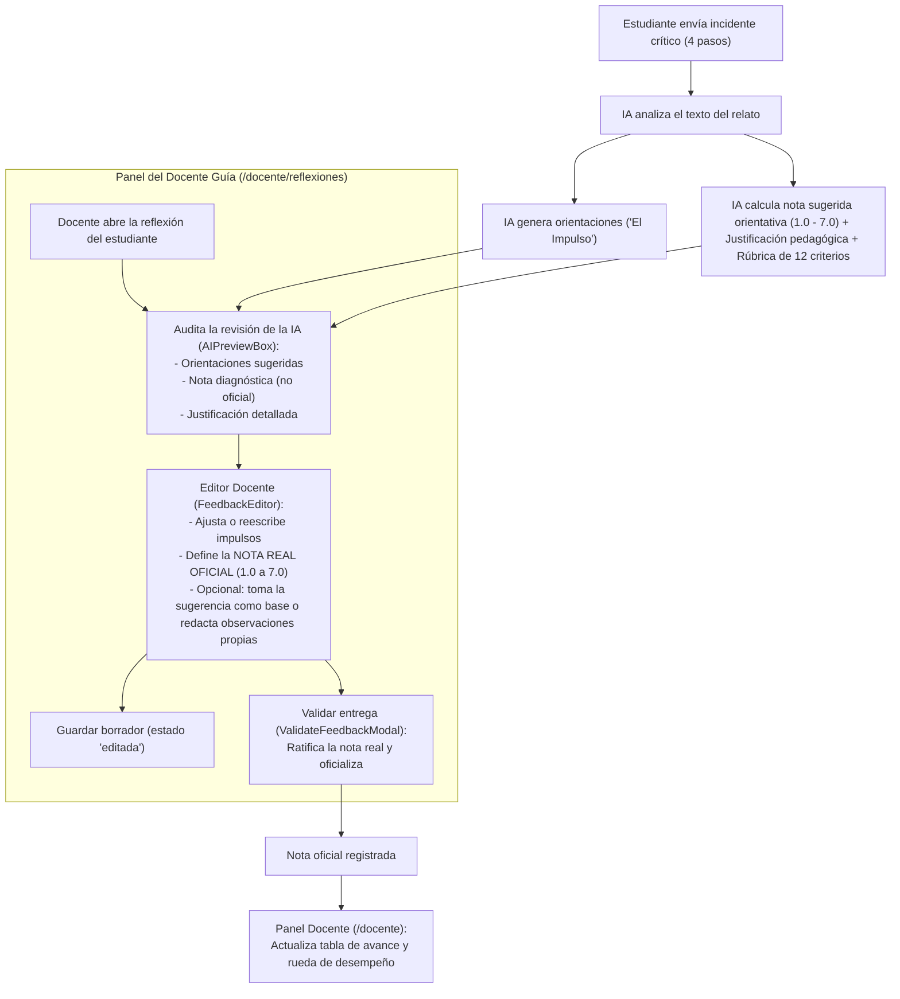

# 🎓 Gobernanza Pedagógica y Calificación Humana en ReflexIA

> **Documento Técnico y Pedagógico de Implementación**  
> **Módulo:** Revisión de Retroalimentación y Calificación Docente (HU-02 / RF-02)  
> **Principio Clave:** *Human-in-the-Loop* — La IA asiste y diagnostica; el docente evalúa y califica.  
> **Fecha:** 12 de octubre de 2026  
> **Estado:** Implementado y verificado en Frontend  

---

## 1. 🎯 Justificación y Principio Rector

Durante la retroalimentación institucional del proyecto, se estableció una directriz académica no negociable:

> ⚠️ **Directriz Pedagógica Fundamental:**  
> **Las notas de los estudiantes NUNCA deben ser asignadas por la Inteligencia Artificial ni aplicarse de forma automática.**  
> La evaluación formativa y sumativa de un futuro docente es un acto pedagógico complejo, ético y contextual. La IA no conoce la trayectoria humana del practicante ni las particularidades de su aula. Por tanto, la IA actúa exclusivamente como una herramienta de diagnóstico preliminar, entregando sugerencias y justificaciones transparentes, mientras que **la calificación real y oficial es potestad exclusiva del docente guía.**

Este documento detalla la arquitectura, modelos, componentes de interfaz y lógica de sincronización implementados para cumplir rigurosamente con este mandato.

---

## 2. 🔄 Flujo de Trabajo (Human-in-the-Loop)



---

## 3. 🧩 Desglose de Cambios por Componente

### 3.1. Modelos de Datos

#### A. Contrato de la IA ([`src/models/criticalIncident.ts`](file:///c:/Users/joaqu/Documents/Github/reflexIA/src/models/criticalIncident.ts))
Se enriqueció `AIFeedback` para incluir el diagnóstico evaluativo sin que represente una nota oficial:

```typescript
export interface RubricCriterionResult {
  step: IncidentStep;
  key: string;
  label: string;
  isMet: boolean;
  points: number;
  maxPoints: number;
}

export interface AIFeedback {
  id: string;
  workshopId: string;
  attemptNumber: number;
  hints: AIFeedbackHint[];
  generalComment: string;
  /** Nota sugerida por la IA (escala 1.0 a 7.0). Solo diagnóstica, nunca automática ni oficial. */
  suggestedGrade: number;
  /** Justificación pedagógica del puntaje sugerido por la IA. */
  gradeJustification: string;
  /** Desglose de cumplimiento de 12 criterios analizados. */
  rubricBreakdown?: RubricCriterionResult[];
  createdAt: string;
}
```

#### B. Contrato de la Revisión Docente ([`src/models/reflection.ts`](file:///c:/Users/joaqu/Documents/Github/reflexIA/src/models/reflection.ts))
Se separó la versión propuesta por la IA de la decisión real del profesor:

```typescript
export interface ReflectionReview {
  status: ReviewStatus;
  hints: AIFeedbackHint[];
  generalComment: string;
  /**
   * Nota real asignada por el docente guía (escala chilena de 1.0 a 7.0).
   * La IA solo sugiere una nota diagnóstica; la nota real es potestad humana
   * y exclusiva del docente. Es null si aún no ha sido calificada.
   */
  assignedGrade: number | null;
  /** Observaciones pedagógicas o justificación del docente sobre la nota real. */
  gradeNotes?: string;
  reviewedAt: string | null;
}
```

---

### 3.2. Motor de Sugerencia Diagnóstica y Rúbrica ([`src/utils/impulseGenerator.ts`](file:///c:/Users/joaqu/Documents/Github/reflexIA/src/utils/impulseGenerator.ts))

Para que la nota sugerida no sea una "caja negra", se estructuró una **rúbrica analítica de 12 criterios pedagógicos** distribuidos homogéneamente en los 4 pasos del incidente:

| Paso | Criterio | Descripción evaluada | Ponderación |
|---|---|---|---|
| **Contexto** | `group` | Identificación de características del grupo escolar (cantidad, edades, nivel). | +0.5 pts |
| **Contexto** | `infrastructure` | Entorno físico, patio/gimnasio y recursos o materiales disponibles. | +0.5 pts |
| **Contexto** | `prior-knowledge` | Conocimientos previos o contenidos previos de la unidad. | +0.5 pts |
| **Descripción** | `moment` | Momento específico o secuencia temporal en la que ocurrió el incidente. | +0.5 pts |
| **Descripción** | `actions` | Acciones objetivas y conductas de las partes involucradas. | +0.5 pts |
| **Descripción** | `outcome` | Desenlace inmediato y consecuencias observadas tras el hecho. | +0.5 pts |
| **Actores** | `who` | Identificación de los actores por sus roles pedagógicos (sin nombres reales). | +0.5 pts |
| **Actores** | `influence` | Análisis de la influencia e interacción de cada actor en la situación. | +0.5 pts |
| **Actores** | `own-role` | Autopercepción, postura y rol activo del docente en formación (practicante). | +0.5 pts |
| **Relevancia** | `significance` | Sentido formativo y aprendizaje pedagógico derivado del evento. | +0.5 pts |
| **Relevancia** | `theory` | Articulación explícita con marcos teóricos (Dewey, Schön, Tripp, etc.). | +0.5 pts |
| **Relevancia** | `future` | Proyección futura, estrategia o propuesta de innovación y mejora docente. | +0.5 pts |

#### Algoritmo de Calificación Diagnóstica
- **Escala:** Escala chilena (1.0 a 7.0, aprobatoria con 4.0).
- **Fórmula:**  
  $$\text{Nota sugerida} = 1.0 + (\text{criterios cumplidos} \times 0.5)$$
- **Redacción de Justificación:** El sistema compila automáticamente un informe narrativo indicando fortalezas observadas (criterios logrados) y vacíos pendientes (criterios omitidos), cerrando con el descargo de responsabilidad docente obligatorio.

---

### 3.3. Interfaz del Profesor Guía (`/docente/reflexiones`)

#### A. Caja de Revisión Diagnóstica ([`src/views/reflections/components/AIPreviewBox.tsx`](file:///c:/Users/joaqu/Documents/Github/reflexIA/src/views/reflections/components/AIPreviewBox.tsx))
- **Badge Prominente:** Señala la nota sugerida por la IA (ej. `5.5 / 7.0`).
- **Tarjeta de Justificación:** Explica el porqué de la sugerencia pedagógica con categorías de desempeño (`Sobresaliente`, `Aprobado` o `Reprobado`).
- **Desglose Interactivo:** Acordeón que permite desplegar los 12 criterios evaluados con indicadores visuales de aprobado/pendiente (`CheckCircle2` / `XCircle`).
- **Aviso Institucional:** Etiqueta visible: *"La IA nunca asigna la nota oficial"*.

#### B. Editor y Asignación de Calificación ([`src/views/reflections/components/FeedbackEditor.tsx`](file:///c:/Users/joaqu/Documents/Github/reflexIA/src/views/reflections/components/FeedbackEditor.tsx))
- **Módulo de Calificación Oficial:**
  - Campo numérico para la **Nota real** (1.0 a 7.0, paso 0.1).
  - Indicador reactivo del estado de desempeño chileno según los umbrales de ReflexIA:
    - `< 4.0`: Reprobado (`text-perf-fail` / borde semántico).
    - `4.0 – 4.9`: Aprobado (`text-perf-pass`).
    - `5.0 – 7.0`: Sobresaliente (`text-perf-excellent`).
  - Botón de conveniencia: **"Tomar nota sugerida (X.X) como base"** para permitir al docente adoptar la sugerencia con un clic o modificarla según su criterio.
  - Textarea para **Fundamentación u observaciones docentes de la nota**.
- **Bloqueo Preventivo de Validación:** El botón de validación permanece deshabilitado si el docente no ha colocado una nota real numérica válida, impidiendo que una reflexión sea dada por cerrada sin calificación humana.

#### C. Modal de Ratificación ([`src/views/reflections/components/ValidateFeedbackModal.tsx`](file:///c:/Users/joaqu/Documents/Github/reflexIA/src/views/reflections/components/ValidateFeedbackModal.tsx))
- Exhibe en una tarjeta destacada:
  1. **Nota real asignada por el docente** (con badge oficial).
  2. **Nota orientativa sugerida por la IA** (como referencia diagnóstica).
  3. **Observaciones redactadas por el docente**.
- Mensaje de confirmación: *"Al confirmar, la calificación y orientaciones quedan oficialmente validadas por ti como docente guía para este taller."*

#### D. Lista de Reflexiones ([`src/views/reflections/components/ReflectionListItem.tsx`](file:///c:/Users/joaqu/Documents/Github/reflexIA/src/views/reflections/components/ReflectionListItem.tsx))
- Cada elemento de la lista indica su estado evaluativo:
  - Validada: `Nota real: 6.0` con ícono de premiación (`Award`).
  - Pendiente: `Sugerida: 5.5 (Pendiente)` con ícono de IA (`Sparkles`), recordando al docente que falta su calificación.

---

### 3.4. Capa de Servicios y Sincronización Global

#### A. Persistencia en [`reflectionService.ts`](file:///c:/Users/joaqu/Documents/Github/reflexIA/src/services/reflectionService.ts)
- `saveEdit`: Permite guardar borradores de notas y observaciones docentes en `localStorage` particionado por usuario.
- `validate`: Valida que exista una nota real en el rango [1.0, 7.0] y actualiza el estado a `'validated'`.

#### B. Sincronización en [`teacherDashboardService.ts`](file:///c:/Users/joaqu/Documents/Github/reflexIA/src/services/teacherDashboardService.ts)
- La función generadora de la tabla general del panel docente (`/docente`) consulta el almacén de revisiones del profesor (`reflexia_reflection_reviews`).
- Cuando el profesor valida la reflexión de un estudiante con una nota real en `/docente/reflexiones`, esa nota **se propaga de inmediato a la matriz de avance general del estudiante** en el panel principal, actualizando su situación (`Aprobado`, `Sobresaliente` o `Reprobado`).

---

## 4. 🛡️ Garantías de Calidad y Cumplimiento

1. **Autonomía Docente:** La plataforma no impone ni restringe la nota que el docente decida colocar, respetando su libertad de cátedra y criterio evaluativo.
2. **Transparencia Algorítmica:** La IA no entrega notas arbitrarias; desglosa los criterios observables en el texto del alumno para que el profesor entienda exactamente cómo se calculó la estimación.
3. **Validación de Integridad:** El build general del sistema (`tsc && vite build`) compila con **0 errores**, asegurando compatibilidad completa de tipos TypeScript en todos los módulos intervenidos.
